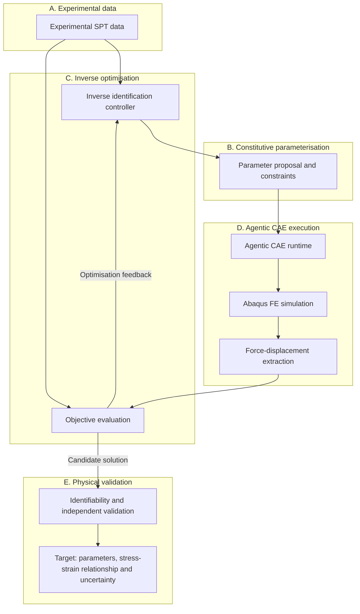
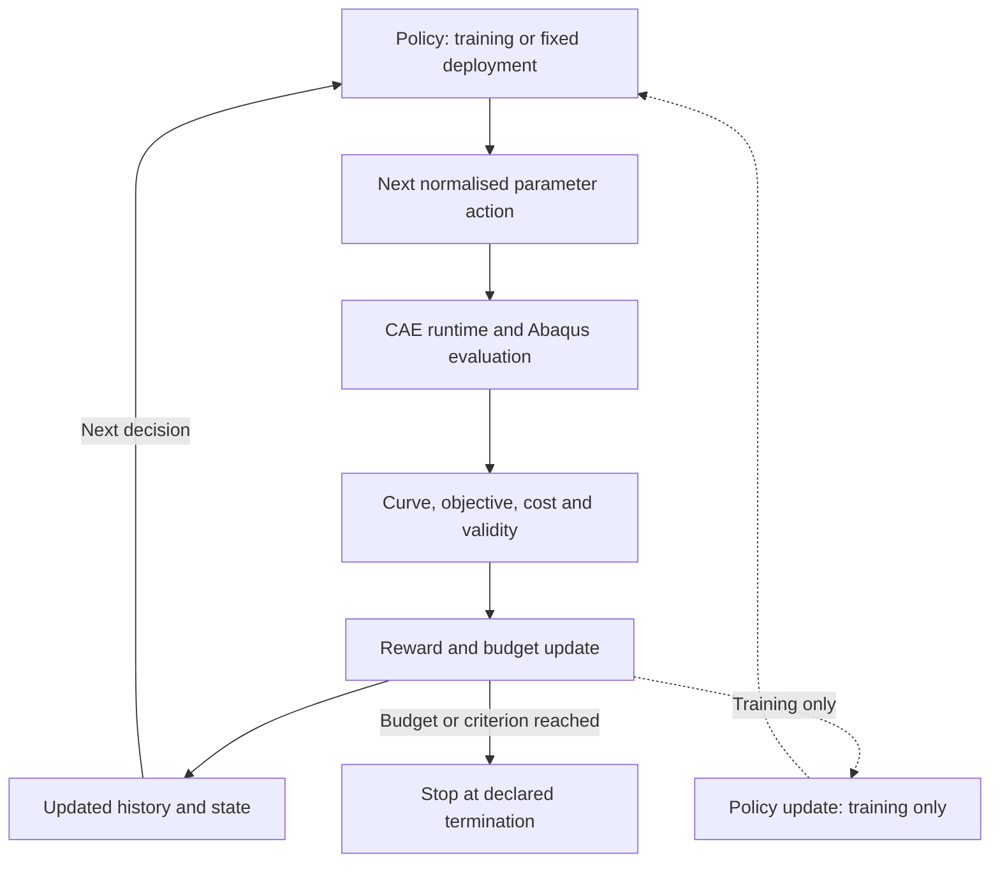

[English](README.md) | [简体中文](README.zh-CN.md)

# SP-InvOpt

**Agentic CAE and Learning-Based Constitutive Inverse Identification from Small Punch Tests**

SP-InvOpt — Small Punch Inverse Optimisation — is a research framework under development for inverse identification of elastoplastic constitutive parameters from experimental Small Punch Test (SPT) force–displacement curves. It aims to combine parameterised Abaqus simulations, automated CAE execution, numerical optimisation, surrogate modelling and reinforcement learning to investigate efficient and physically credible material identification.

> Research in progress — experimental and numerical validation pending. The repository remains **SMALL-PUNCH**. This is not yet a validated identification tool.

## 1. Project Overview

The physical inverse problem is the centre of the project. Abaqus is the intended high-fidelity forward solver; Agentic CAE is the planned execution architecture. Numerical optimisation provides essential baselines. Reinforcement learning (RL) is a research hypothesis whose value must be demonstrated against those baselines.

The current deliverables are project infrastructure, environment and source-file audit records, and research documentation. Automated inverse identification, Bayesian optimisation, surrogates, RL and end-to-end CAE integration are **not implemented**.

[Research overview](docs/Research_Overview.md) · [Architecture contract](docs/Research_Architecture.md) · [Run index](run/README.md) · [Project status](status/PROJECT_STATUS.md)

## 2. Physical Problem: Small Punch Test

A typical SPT setup comprises a thin circular disc specimen, a central spherical or hemispherical punch, and a clamping/supporting die. Punch displacement is applied and the corresponding reaction force or applied load is measured. This describes the intended physical problem; the actual project geometry and instrumentation remain unconfirmed.


*Original conceptual section at initial contact; not to scale. The axial load cell indicates force measurement, not a verified sensor arrangement. The force arrow shows the reaction on the punch; the imposed displacement points downward.*

$$
F_{\mathrm{exp}}(u), \qquad
F_{\mathrm{FE}}(u)=\mathcal{M}(\theta,G,\mathrm{BC},\mu)(u)
$$

Here, $u$ is punch displacement, $F$ is force, $\theta$ denotes constitutive parameters, $G$ geometry and specimen dimensions, $\mathrm{BC}$ boundary conditions, and $\mu$ friction parameters.

The response may involve elastic deformation, plastic bending, membrane stretching and nonlinear contact, with possible damage or failure at larger deformation. Whether damage or fracture belongs in the model depends on the actual CAE model and experimental evidence; neither is currently implemented or validated here. Punch shape, die constraints, friction and specimen geometry can all influence the inverse result.

**Machine crosshead displacement need not equal actual punch displacement.** Machine compliance, fixture deformation and displacement offsets can introduce systematic error. Their treatment must be established before comparing measured and simulated curves.

## 3. Research Objectives

- Establish a reproducible and auditable path from experimental data to parameterised FE evaluations.
- Identify yield strength and strain-hardening exponent, with an extensible parameter interface.
- Compare Grid Search, Differential Evolution and Bayesian Optimisation under controlled computational budgets.
- Investigate surrogate-assisted and learned sequential search across repeated identification tasks.
- Assess parameter identifiability, uncertainty and independent physical validity, beyond curve fitting.

The intended criterion is **efficient, reliable, physically credible and transferable identification**. No improvement in accuracy or computational cost has yet been demonstrated.

## 4. Proposed Research Architecture

All computational links below are **proposed**. The final node describes target research outputs, not existing results.



The planned CAE layer covers model preflight, material parameter updates, job scheduling, status monitoring, ODB result extraction, failure diagnostics, and run provenance/logging. Physical validation additionally requires independent evidence; the optimisation loop alone cannot supply it.

[AbqJobPilot](https://github.com/BrunelXian/AbqJobPilot) is a potential external execution layer, **not an integrated dependency**. Project-side interfaces `preflight`, `enqueue`, `status`, `locate_outputs`, `extract_results` and `failure_diagnostics` remain planned and unverified against an actual adapter.

Agentic CAE does not imply direct LLM control of the Abaqus GUI. The design prioritises repeatable parameterised models, explicit job interfaces and structured result extraction, with failures preserved as diagnosable records.

## 5. Constitutive Model

The initial candidate is a Hollomon elastoplastic relation:

$$
\sigma=K\varepsilon^n
$$

A candidate continuous piecewise form, conditional on agreement with the source literature and CAE definition, is:

$$
\sigma(\varepsilon)=
\begin{cases}
E\varepsilon, & \varepsilon\leq\varepsilon_y,\\
E\varepsilon_y^{1-n}\varepsilon^n, & \varepsilon>\varepsilon_y,
\end{cases}
\qquad \varepsilon_y=\frac{\sigma_y}{E}
$$

$$
\theta=[\sigma_y,n], \qquad K=E\varepsilon_y^{1-n}
$$

$\sigma_y$ is yield strength, $n$ the strain-hardening exponent, $E$ Young's modulus and $K$ the strength coefficient. The expression for $K$ follows from this particular continuity convention; it is not a separate free parameter in that parameterisation. Initially, $E$ is treated as known, with an interface for later inference. No numerical material values or parameter bounds are approved here.

| Quantity | Meaning and distinction |
| --- | --- |
| Engineering stress / strain | Based on initial specimen dimensions. |
| True stress / strain | Based on current area and, for uniform uniaxial strain, logarithmic stretch. |
| Total strain | Includes elastic and plastic contributions. |
| Plastic strain | Excludes the elastic contribution; not interchangeable with total strain. |
| Equivalent plastic strain | Accumulated scalar measure under the chosen plasticity model; not an arbitrary strain component. |

Conventional Abaqus metal plasticity tables typically require true yield stress versus equivalent plastic strain, starting at zero plastic strain. In uniaxial calibration with small elastic strains, plastic strain is obtained by subtracting the **current** true stress divided by $E$ from true total strain. Do not pass total strain directly to `*Plastic`. See the [Abaqus documentation mirror](https://abaqus.uclouvain.be/English/SIMACAEGSARefMap/simagsa-c-matdefining.htm) and the [project constitutive contract](docs/Constitutive_Model.md) for assumptions and version limitations.

**Open questions:** the strain measure used in the source Hollomon expression, its consistency with the eventual CAE material definition, and a previously recorded strain-offset discrepancy remain unresolved. A fixed yield-strain offset is not automatically equivalent to subtracting the current elastic strain. These differences must be resolved explicitly before generating material tables; no source convention is silently selected.

## 6. Inverse Identification Formulation

With geometry, boundary conditions and friction specified or explicitly treated as uncertain, the initial inverse problem is:

$$
\theta^*=\operatorname*{arg\,min}_{\theta\in\Theta}\mathcal{L}(\theta),
\qquad
\mathcal{L}(\theta)=\sum_i w_i
\left[F_{\mathrm{FE}}(u_i;\theta)-F_{\mathrm{exp}}(u_i)\right]^2
$$

$\Theta$ denotes admissible physical parameters and $w_i\geq0$ the comparison weights. Normalisation, regularisation, parameter constraints and uncertainty assessment are possible extensions; their definitions remain to be chosen and recorded.

Experimental and FE curves must be compared on a common displacement coordinate and a justified overlapping interval. Alignment, interpolation, loading/unloading branches, experimental noise, displacement offset, machine compliance, contact conditions and geometric uncertainty must be considered consistently. Nuisance parameters cannot be silently absorbed into material parameters.

**Good force–displacement agreement does not automatically guarantee unique or physically correct constitutive parameters.** Several parameter sets or modelling assumptions may produce near-equivalent curves.

## 7. Role of Reinforcement Learning

The proposed direction is **Budget-Aware Sequential Constitutive Parameter Identification**: learn where to spend the next FE evaluation within a limited Abaqus budget.

The RL agent proposes the next material parameter location. The CAE runtime executes that evaluation reliably and returns structured evidence. RL does not modify the governing mechanics or replace the Abaqus solver.

Grid Search, Differential Evolution and Bayesian Optimisation are the required initial baselines. PPO, SAC and other suitable sequential decision-making methods are later candidates; their applicability has not been established. For a single inverse problem with only two parameters, conventional optimisation may be more efficient.

Potential value is expected primarily in repeated identification tasks, cross-material transfer, learned sequential search policies, limited FE budgets and surrogate-assisted exploration. These are hypotheses, not reported benefits. **RL is not assumed to outperform Bayesian Optimisation.**

The proposed loop separates FE evaluation, reward/state updates and policy training. Dashed links apply only during training; inference can use a fixed policy. No part of this loop has been implemented.



## 8. MDP Formulation

The following is a proposed formulation for a fixed identification task, not an implemented or validated environment.

### State

$$
s_t=\left(\mathcal{D}_t,\theta_{\mathrm{best},t},\mathcal{L}_{\mathrm{best},t},B_t\right)
$$

$\mathcal{D}_t$ contains completed parameter–CAE evaluations, including objective values, costs and validity/failure information. The remaining terms are the best valid parameters, best valid loss and remaining computational budget. Before a valid incumbent exists, the state needs an explicit initialisation indicator.

The growing dataset cannot be assumed to fit a fixed-dimensional policy input. Future options include fixed-dimensional features, history or set encoders, or a surrogate-based summary. Cross-task policies also need experiment and model context. Whether a compressed representation retains sufficient information for a Markov formulation must be assessed.

### Action

$$
a_t=\theta_{t+1}
\quad\text{or}\quad
a_t=\Delta\theta_t
$$

An action selects a complete parameter vector or a local update. Physical parameters have different units and scales, so policy optimisation should use a normalised action space with an explicit mapping to admissible physical bounds. Neither bounds nor mapping are implemented yet.

### Reward

$$
r_t=\mathcal{L}_{\mathrm{best},t}-\mathcal{L}_{\mathrm{best},t+1}-\lambda_c C_t
$$

This is an initial reward proposal: improvement in best valid loss minus a computational-cost penalty. $C_t$ represents actual CAE evaluation cost, with declared units/normalisation, and $\lambda_c$ sets the trade-off. Loss scaling and cost scaling must be defined together. The reward requires a valid incumbent; initialisation and failure handling need separate rules.

### Transition and termination

After an Abaqus evaluation, update the evaluated parameter set, objective/validity record, best-known valid solution and remaining budget. For a call-count budget, each attempted evaluation consumes a declared count; for a time budget, debit measured time. Failed evaluations must also consume their actual resources.

Terminate when the FE evaluation budget is exhausted, an agreed objective threshold is reached, or declared numerical termination criteria are met. Reaching an objective threshold is not proof of physical validity.

Failed or invalid solves need an explicit failure state and penalty/cost rule. They must never yield a fabricated low loss or positive improvement reward. Timeout, retry and termination policies must prevent exploiting exceptional solver behaviour.

**RL training cost and inference-time FE evaluation cost must be reported separately.** Training data generation, surrogate fitting, policy training and tuning contribute to total cost. Any advantage from amortisation across tasks requires measured evidence and held-out evaluation.

## 9. Research Questions

| Question | Focus and evaluation |
| --- | --- |
| **RQ1 — Computational Efficiency:** Can learning-based sequential optimisation reduce the number of high-fidelity FE evaluations required for identification? | FE evaluations, wall-clock time, best objective, success rate, and total training plus deployment cost. |
| **RQ2 — Parameter Identifiability:** To what extent can yield strength and strain-hardening exponent be uniquely and robustly identified from SPT responses? | Sensitivity, parameter correlation, experimental noise, contact uncertainty, confidence regions and multiple near-equivalent solutions. |
| **RQ3 — Generalisation and Transferability:** Can a learned optimisation strategy transfer across materials, parameter ranges, geometries or experimental conditions? | Held-out materials, unseen parameter combinations, changed test conditions, cross-task transfer and out-of-distribution behaviour. |

Comparisons should share FE budgets, data splits, objective definitions and termination rules, with repeated trials and reported failures. Numerical fitting and independent physical validation must remain distinct.

## 10. Research Roadmap

Statuses describe actual progress: **Completed**, **In Progress**, **Planned**, or **Blocked**. Completion of an audit is not completion of CAE validation.

| Stage | Scope | Status |
| --- | --- | --- |
| **1 — Foundation and CAE Sanity** | Project structure, raw-file inventory, environment verification and research documentation; baseline CAE validation and force–displacement extraction. | **In Progress**. Foundation/documentation: **Completed with warnings**. Baseline CAE validation and extraction: **Blocked** pending auditable model inputs and clarified data/constitutive definitions. |
| **2 — Automated Inverse Identification** | Hollomon parameterisation, objective function, Grid Search, Differential Evolution and Bayesian Optimisation. | **Planned**; requires validated Stage 1 inputs. |
| **3 — Surrogate and Learning-Based Optimisation** | FE dataset, surrogate model, RL environment, PPO/SAC feasibility and same-budget benchmarking. | **Planned**. |
| **4 — Physical Validation and Paper** | Identifiability, experimental uncertainty, independent material validation, generalisation, ablations and manuscript preparation. | **Planned**; no paper or validation result claimed. |

## 11. Repository Structure

The following directories exist locally. The research module directories currently reserve structure; their existence does not imply implemented software or available models.

```text
SMALL-PUNCH/
├── AGENTS.md
├── README.md
├── README.zh-CN.md
├── .gitignore
├── docs/                  # Research and technical contracts
│   └── figures/           # Original scientific SVG schematics
├── status/                # Project status
├── CAE/
│   ├── Models/            # Model sources/work copies and generated models
│   └── Scripts/           # Future parameterisation and extraction scripts
├── experiments/           # Explicitly imported research datasets
├── inverse/               # Future inverse identification code
├── run/
│   ├── README.md          # Run index
│   ├── run_001/           # Foundation and audit records
│   └── run_002/           # Bilingual research documentation
├── tests/                 # Lightweight foundation checks
└── references_private/    # Immutable originals; ignored by Git, local only
```

Working CAE models belong under `CAE/`; immutable private originals remain untouched. `CAE/Jobs/` is a **planned**, ignored solver workspace and is not present yet. Every independent research run uses `run/run_XXX/` with `run.json`, `summary.md`, `artifacts/` and `checkpoints/`. Artifacts preferentially reference actual outputs by traceable repository-relative paths rather than duplicate large files. See the [file communication protocol](docs/Agent_File_Communication_Protocol.md).

## 12. Computing Environment

The run_001 audit on **2026-10-10** verified an external **Python 3.11.13** environment with NumPy, SciPy, Pandas and Matplotlib, plus scikit-learn and optional PyTorch/RL dependencies: PyTorch, Gymnasium and Stable-Baselines3. All eight packages imported successfully. This is an observed local environment, not a portable dependency lock or an installation guarantee.

**Abaqus 2024** release and built-in **Python 3.10.5** queries succeeded. Licence checkout, CAE startup and Solver execution were not tested. External research Python and Abaqus Python must remain separate processes, exchanging structured files; Abaqus Python is not assumed to import external scientific or ML packages. Machine-specific interpreter paths belong in local development/run records, not public setup requirements.

No package installer or runnable inverse pipeline is provided yet. Exact observed versions are in the [environment audit](run/run_001/artifacts/environment.json). No new dependencies were installed for this documentation run.

## 13. Current Project Status

Status as of **2026-10-10**, based on run_001 evidence and the run_002 documentation update:

| Area | Evidence-based status |
| --- | --- |
| Project foundation | Completed with warnings; **run_001 = WARNING**. |
| Original research files | Five files privately preserved; migration SHA-256 checks matched. |
| Python environment | Verified by version queries and eight package imports. |
| Abaqus installation | Release and Python queries verified; solver/licence capability untested. |
| Lightweight foundation checks | 17 checks passed; not numerical or physical validation. |
| CAE model audit | Pending/unresolved; no auditable model input confirmed. |
| Experimental curve validation | Pending; no validated SPT force–displacement dataset. |
| Constitutive definition | Requires clarification before material-table generation. |
| Automated inverse identification / surrogate / RL | Not implemented. |
| Agentic CAE / AbqJobPilot integration | Planned, not integrated or validated. |
| Research README | English and Chinese documentation prepared; run_002 remains **WARNING**, with no commit or push due to mixed pre-existing changes. |

See [run_001](run/run_001/summary.md), [run_002](run/run_002/summary.md) and [project status](status/PROJECT_STATUS.md). This repository contains no claimed identification benchmark or experimentally validated material result.

## 14. Reproducibility and Data Policy

`references_private/` is an immutable, Git-ignored source area and must never serve as an Abaqus working directory. Legacy names `materials/` and `Materials/` remain ignored. Private source files, sensitive measurements and detailed local provenance are not published in this README or uploaded as part of this task.

Research data must enter `experiments/`, and model working copies `CAE/`, through an explicit import/preprocessing process with source identity, SHA-256, transformation settings, units, version and output provenance. Import does not automatically grant publication rights. ODB, SIM, LCK and solver intermediates must not be committed.

Run records capture Git HEAD, inputs, outputs, validation, errors and known timestamps. The framework supports an auditable research workflow; **reproduction of scientific results is not yet possible from this repository alone**, because validated models and experimental inputs are still absent. See [data management](docs/Data_Management.md).

## 15. Limitations and Research Boundaries

1. A single SPT force–displacement curve may not uniquely identify all constitutive parameters.
2. Friction, punch/die geometry, specimen dimensions and machine compliance can influence inverse results.
3. Constitutive identification is conditional on the chosen forward model and its assumptions.
4. Hollomon may not represent every strain-hardening regime; damage/fracture requires separate justification.
5. Excellent FE curve fitting does not establish material-model validity.
6. RL superiority is a hypothesis requiring controlled comparison, including training and deployment costs.
7. Physical validation and parameter identifiability must be assessed independently of numerical fit quality.

## 16. Citation and Contact

No associated publication, DOI or formal citation has been established in this repository. Until one exists, reference the repository URL and the specific revision used; no author list or BibTeX entry is invented.

Repository and project enquiries: [SHUAIXSYU/SMALL-PUNCH](https://github.com/SHUAIXSYU/SMALL-PUNCH). Use the repository's available discussion/issue channels for public questions; do not post private research data.
