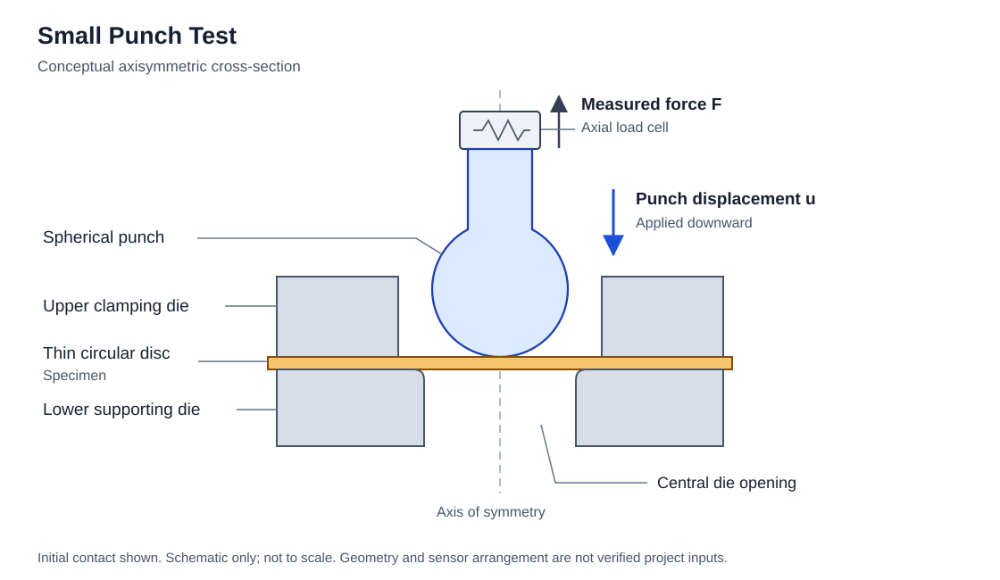
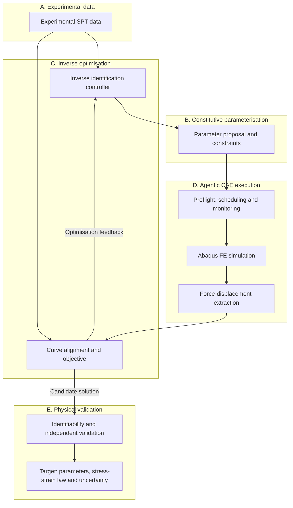
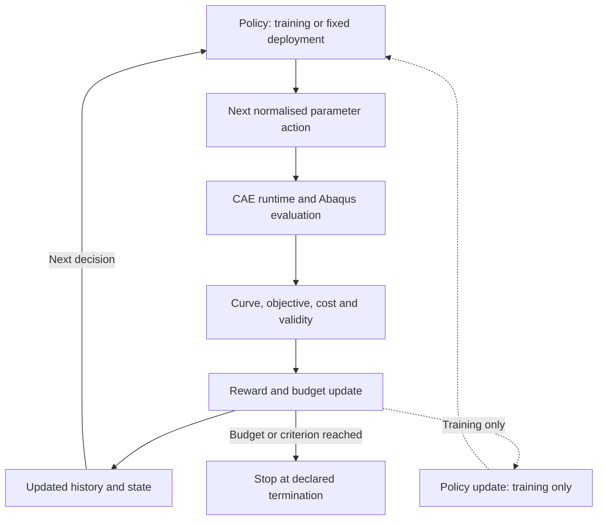

[English](README.md) | [简体中文](README.zh-CN.md)

<h1 align="center">SP-InvOpt</h1>
<p align="center"><strong>Small Punch Inverse Optimisation</strong><br/>Constitutive parameter identification through reproducible CAE and sequential optimisation.</p>
<p align="center"><strong>Research in progress · Stage 1 · Physical validation pending</strong></p>

SP-InvOpt investigates how experimental Small Punch Test (SPT) force–displacement curves can identify elastoplastic material parameters. The proposed framework connects parameterised Abaqus simulations, auditable CAE execution and numerical optimisation, then studies whether surrogate models and learned search policies improve repeated inverse tasks.

**Physics first. Reproducibility before optimisation. Baselines before RL. Validation before claims.**

[Start here](#start-here) · [Research workflow](#research-workflow) · [Documentation](#documentation) · [Roadmap](#roadmap)

## Physical problem



*Original section at initial contact, not to scale. The axial load cell is illustrative, not a verified instrument layout. Force is the reaction on the punch; imposed displacement points downward.*

A thin circular disc is clamped between an upper die and a lower support. A spherical or hemispherical punch loads its centre, producing a measured force–displacement curve. The forward model is:

$$
F_{\mathrm{FE}}(u)=\mathcal{M}(\theta,G,\mathrm{BC},\mu)(u),
\qquad \theta=[\sigma_y,n]
$$

Here $u$ is punch displacement, $G$ geometry, $\mathrm{BC}$ boundary conditions and $\mu$ friction. The initial material parameters are yield strength $\sigma_y$ and hardening exponent $n$; Young's modulus $E$ is initially a known input, with an interface for later inference.

Bending, plastic flow, membrane stretching and contact all affect the response. **Crosshead displacement need not equal actual punch displacement**: compliance and offset must be checked alongside friction, thickness and clamping. Damage/fracture modelling has not been established; a justified fit interval or a validated additional model is needed if failure is included in the data.

## What is available

The repository is named **SMALL-PUNCH**; **SP-InvOpt** is the research project name. It is currently a documented research foundation, not a validated inverse-identification application.

| Area | Available now | Next prerequisite |
| --- | --- | --- |
| Research foundation | Run protocol, private-data policy and bilingual documentation | Auditable model and experimental inputs |
| Computing environment | Recorded Python imports and Abaqus version queries | Licence, solver and forward-model checks |
| Research figures | Original SPT SVG and proposed workflow diagrams | Verification against the actual test setup |
| Inverse optimisation | Mathematical contract and evaluation questions | Parameterisation, objective and Grid/DE/BO implementation |
| Agentic CAE, surrogate and RL | Run_008 project-local MAIN/CAE/ODB AgentHub; candidate INP and read-only AbqJobPilot/ODB checks | Verified Settings, an authorized Solver validation, then optimisation and RL |

The run_001 foundation and run_002 documentation records remain **WARNING**. Their file/environment checks are not CAE or physical validation. See [current status](status/PROJECT_STATUS.md) and the [run index](run/README.md) for evidence; no benchmark improvement or validated material result is claimed.

## Start here

There is no installer or runnable inverse pipeline yet. The useful starting point is the research contract and an inspection of the available evidence.

1. Read [project status](status/PROJECT_STATUS.md) and the [CAE audit](docs/CAE_Model_Audit.md) to see what is still unknown.
2. Review the [constitutive and RL formulation](docs/Inverse_Identification.md) before supplying a model or dataset.
3. From the repository root, use an existing Python 3.11 environment to check the current documentation:

```bash
python -B run/run_003/artifacts/validate_docs.py
```

This command checks documentation and preservation of the current Run's inputs; it does not open private data, call Abaqus or train a model. Earlier Run checks retain their historical scope.

The run_001 audit recorded **Python 3.11.13**, NumPy, SciPy, Pandas, Matplotlib, scikit-learn and optional PyTorch/RL packages (PyTorch, Gymnasium, Stable-Baselines3). **Abaqus 2024** and its **Python 3.10.5** responded to version queries. These are local observations, not a supported-version matrix or dependency lock. See the [exact environment record](run/run_001/artifacts/environment.json).

External research Python and Abaqus Python stay in separate processes with structured file exchange. Abaqus is not assumed to import the external scientific/ML environment. Licence checkout, CAE startup and solver execution remain untested.

## Research workflow

**Research workflow — the Solver/optimisation pipeline is not implemented. Run_008 adds a project-local role coordination bootstrap.**



Agentic CAE is intended to provide parameter updates, preflight, scheduling, monitoring, ODB extraction, failure diagnostics and provenance. Run_008 implemented an isolated MAIN/CAE/ODB SQLite Hub, generated and parsed one candidate INP, and connected to the stable AbqJobPilot v0.2.2 read-only MCP tools. Its Queue and History remained empty. Preflight and dry-run were not invoked because local Project Settings are missing; no Solver or datacheck ran. This bootstrap does not implement a validated forward/inverse pipeline. See the [run_008 record](run/run_008/summary.md) and [architecture contract](docs/Research_Architecture.md).

The initial objective compares experimental and simulated forces on a common displacement coordinate:

$$
\theta^*=\operatorname*{arg\,min}_{\theta\in\Theta}
\sum_i w_i\left[F_{\mathrm{FE}}(u_i;\theta)-F_{\mathrm{exp}}(u_i)\right]^2
$$

Weights, units, alignment, fitting interval, noise treatment, parameter bounds and failure handling must be declared. Normalisation and regularisation are possible extensions. **A close curve fit does not establish unique or physically correct material parameters.**

## Baselines first, learning second

Grid Search, Differential Evolution (DE) and Bayesian Optimisation (BO) are the required initial baselines. RL is a hypothesis for **budget-aware sequential identification**, especially across repeated material/test tasks. For a single two-parameter inverse problem, DE or BO may be more economical.

The policy proposes the next parameter location; CAE executes it. RL changes neither the governing mechanics nor the Abaqus solver. PPO and SAC remain candidates, not selected or validated solutions.



All links are planned. Dashed links apply only to training; deployment can use a fixed policy. Report **training cost separately from deployment-time FE cost**, count failed evaluations and test on held-out tasks. Do not split simulated variants of one experimental curve across training and independent test sets. Full [MDP definitions, reward and termination rules](docs/Inverse_Identification.md) cover history encoding, normalised actions, initialisation and failure penalties.

| Research question | Evidence to seek |
| --- | --- |
| **RQ1 — Efficiency** | FE evaluations, best loss versus budget, wall-clock time, success rate and total training/deployment cost. |
| **RQ2 — Identifiability** | Sensitivity, parameter correlation, noise/contact/thickness perturbations, confidence regions and near-equivalent solutions. |
| **RQ3 — Transferability** | Held-out materials, unseen parameter ranges, changed geometry/test conditions and out-of-distribution behaviour. |

## Scientific boundaries and data

- **Constitutive definition remains open.** Hollomon is a candidate; engineering/true stress–strain, total strain, plastic strain and equivalent plastic strain are not interchangeable. Do not pass total strain to Abaqus `*Plastic`. Resolve source conventions and recorded conversion differences first; see the [material contract](docs/Constitutive_Model.md).
- **Identification is model-dependent.** Friction, geometry, compliance and a limited hardening law can bias results. A single SPT curve may not identify every parameter uniquely; fitting is not physical validation.
- **Independent evidence matters.** Use independent material tests or additional test conditions where available. State the limitation if independent constitutive data cannot be obtained. RL superiority is not assumed.
- **Private originals stay private.** `references_private/` is immutable and Git-ignored, never a solver workspace. Imports must preserve source identity, SHA-256, units and processing provenance. ODB, SIM, LCK and solver intermediates stay out of Git.

Validated models and experimental curves are still missing, so scientific results cannot yet be reproduced from this repository alone. The [data policy](docs/Data_Management.md) governs imports and publication boundaries.

## Documentation

| I want to… | Read |
| --- | --- |
| Understand constitutive assumptions, inverse loss and the MDP | [Research formulation](docs/Inverse_Identification.md) · [中文](docs/Inverse_Identification.zh-CN.md) |
| Check model and measurement uncertainties | [CAE audit](docs/CAE_Model_Audit.md) · [Material contract](docs/Constitutive_Model.md) |
| Understand execution and data ownership | [Architecture](docs/Research_Architecture.md) · [Data management](docs/Data_Management.md) |
| Reuse or edit the original schematic | [Figure guide](docs/figures/README.md) |
| Follow the actual progress and audit trail | [Status](status/PROJECT_STATUS.md) · [Runs](run/README.md) · [File protocol](docs/Agent_File_Communication_Protocol.md) |

## Roadmap

| Stage | Focus | Current state |
| --- | --- | --- |
| **1 — Foundation and CAE sanity** | Structure, data/environment audit, baseline model and force–displacement extraction | **In Progress**; foundation/docs completed with warnings; model validation and extraction **Blocked** pending inputs. |
| **2 — Inverse baselines** | Hollomon parameterisation, objective, Grid Search, DE and BO | **Planned**; requires a verified forward model. |
| **3 — Surrogate and RL** | FE dataset, surrogate, MDP environment, PPO/SAC feasibility and equal-budget comparisons | **Planned**. |
| **4 — Validation and paper** | Identifiability, uncertainty, independent validation, transfer, ablations and manuscript | **Planned**; no publication or result claimed. |

**Next decision gate:** establish the actual experiment/model definitions and a reliable forward response before developing optimisation. If tasks remain few and low-dimensional, establish DE/BO first rather than introduce RL for its own sake.

<details>
<summary>Repository layout</summary>

```text
SMALL-PUNCH/
├── README.md / README.zh-CN.md
├── AGENTS.md
├── docs/                  # Research contracts and bilingual detailed formulation
│   └── figures/           # Original SPT schematic
├── status/                # Current project state
├── CAE/Models/            # Model working copies and generated models
├── CAE/Scripts/           # Future parameterisation/extraction scripts
├── experiments/           # Explicitly imported datasets
├── inverse/               # Future inverse controller and algorithms
├── run/run_XXX/           # run.json, summary.md, artifacts/, checkpoints/
├── tests/                 # Historical foundation checks
└── references_private/    # Local-only immutable originals; ignored
```

Existing directories do not imply implemented modules. `CAE/Jobs/` remains a planned, ignored solver workspace. Run artifacts use repository-relative references; large models belong under CAE.

</details>

## Citation, contact and licensing

For project enquiries, use the available channels at [SHUAIXSYU/SMALL-PUNCH](https://github.com/SHUAIXSYU/SMALL-PUNCH). No associated DOI, publication or formal author list is established; reference the repository and the revision used rather than a fabricated paper citation.

No project licence file is currently present. Reuse terms have not been documented here; contact the repository owner for the intended licensing arrangement. Third-party tools retain their own licences.
