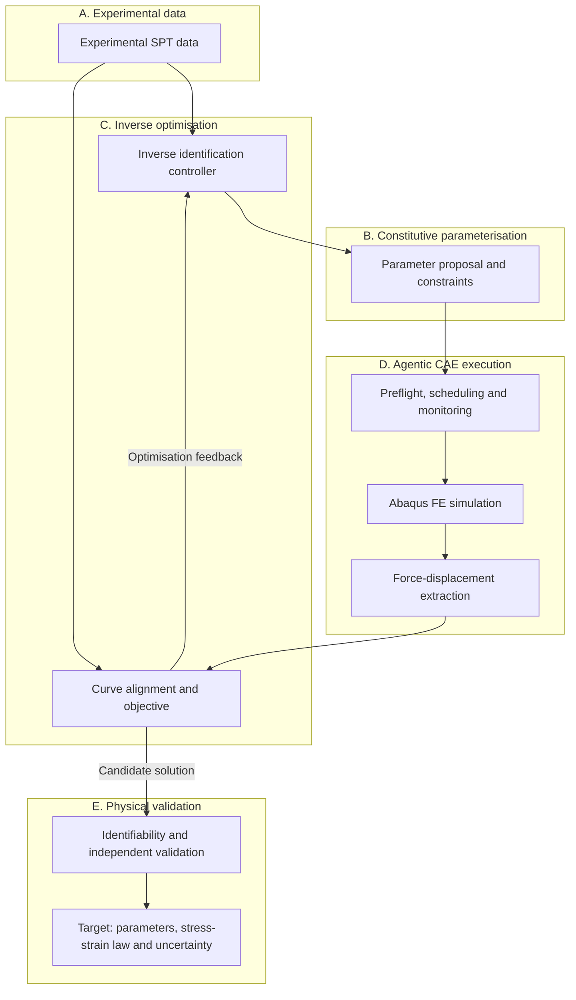
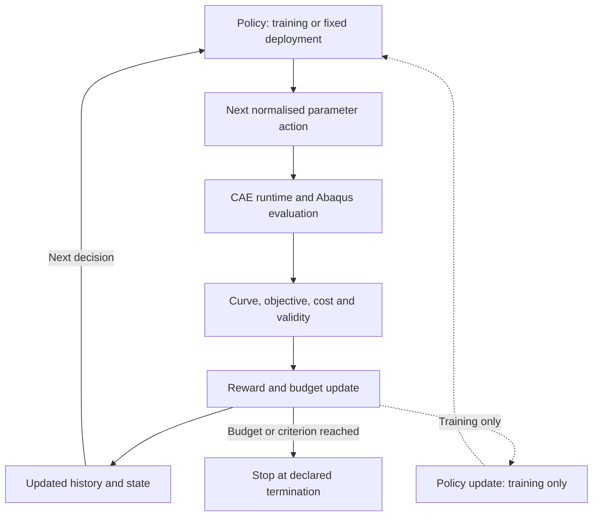

[English](README.md) | [简体中文](README.zh-CN.md)

<h1 align="center">SP-InvOpt</h1>
<p align="center"><strong>Small Punch Inverse Optimisation</strong><br/>以可复现 CAE 与序贯优化开展小冲杆试验本构参数反演。</p>
<p align="center"><strong>研究进行中 · Stage 1 · 物理验证待完成</strong></p>

SP-InvOpt 研究如何从实验小冲杆试验（SPT）力–位移曲线识别材料弹塑性本构参数。拟议框架连接参数化 Abaqus 仿真、可审计的 CAE 执行和数值优化，再研究代理模型与学习型搜索策略能否改善重复反演任务。

**物理问题优先，可复现先于优化，基线先于 RL，验证先于结论。**

[从这里开始](#从这里开始) · [研究工作流](#研究工作流) · [文档导航](#文档导航) · [研究路线图](#研究路线图)

## 物理问题


*原创初始接触截面示意，不按实际比例绘制。轴向载荷传感器仅作示意，不代表已核验的仪器布置；力箭头表示压头所受反力，施加位移方向向下。*

薄圆片试样夹持于上模与下支承模之间，中心由球形或半球形压头加载，得到测量力–位移曲线。有限元正向模型为：

$$
F_{\mathrm{FE}}(u)=\mathcal{M}(\theta,G,\mathrm{BC},\mu)(u),
\qquad \theta=[\sigma_y,n]
$$

其中 $u$ 为压头位移，$G$ 为几何，$\mathrm{BC}$ 为边界条件，$\mu$ 为摩擦。初始识别参数为屈服强度 $\sigma_y$ 和应变硬化指数 $n$；杨氏模量 $E$ 初期视为已知输入，并保留以后参与反演的接口。

弯曲、塑性流动、膜拉伸和接触共同影响响应。**横梁位移不一定等于真实压头位移**：设备柔度和零点偏差需要与摩擦、厚度及夹持条件一并核查。损伤/断裂模型尚未确立；若数据包含失效阶段，需论证限定拟合区间，或采用另行验证的附加模型。

## 当前可用内容

Git 仓库名称为 **SMALL-PUNCH**，研究项目名称为 **SP-InvOpt**。当前交付是有文档和记录的研究基础架构，尚不是经过验证的本构反演应用。

| 领域 | 当前已有 | 下一项前提 |
| --- | --- | --- |
| 研究基础 | Run 协议、私有数据政策和双语文档 | 可审计模型与实验输入 |
| 计算环境 | Python 导入和 Abaqus 版本查询记录 | 许可证、求解器及正向模型检查 |
| 研究图示 | 原创 SPT SVG 和拟议工作流 | 与真实试验系统核对 |
| 反演优化 | 数学契约和评价问题 | 参数化、目标函数及 Grid/DE/BO 实现 |
| Agentic CAE、代理模型与 RL | run_008 已建立项目内 MAIN/CAE/ODB AgentHub，并检查候选 INP 与只读 AbqJobPilot/ODB 接口 | 核实 Settings、另行授权单次 Solver 验证，再开展优化与 RL |

run_001 基础架构和 run_002 文档记录均保留 **WARNING**。文件/环境检查不等于 CAE 或物理验证。证据见[当前状态](status/PROJECT_STATUS.md)与 [Run 索引](run/README.md)；项目不宣称已有性能改善或经过验证的材料结果。

## 从这里开始

目前没有安装器或可执行的反演流水线。适合的起点是理解研究契约，并核查已有证据。

1. 阅读[项目状态](status/PROJECT_STATUS.md)和 [CAE 审计](docs/CAE_Model_Audit.md)，了解尚未确认的条件。
2. 提供模型或数据前，先阅读[本构与 RL 数学定义](docs/Inverse_Identification.zh-CN.md)。
3. 在仓库根目录，使用已有 Python 3.11 环境检查当前文档：

```bash
python -B run/run_003/artifacts/validate_docs.py
```

该命令检查文档及本次 Run 输入的保留情况，不读取私有数据、不调用 Abaqus、不训练模型。旧 Run 的检查仍保留各自的历史适用范围。

run_001 记录的环境为 **Python 3.11.13**，以及 NumPy、SciPy、Pandas、Matplotlib、scikit-learn 和可选 PyTorch/RL 包（PyTorch、Gymnasium、Stable-Baselines3）。**Abaqus 2024** 及其 **Python 3.10.5** 版本查询成功。这是本机观测，不代表版本支持矩阵或依赖锁。具体版本见[环境记录](run/run_001/artifacts/environment.json)。

外部研究 Python 与 Abaqus Python 分进程运行，通过结构化文件交接；不假定 Abaqus 能导入外部科学计算或机器学习环境。许可证签出、CAE 启动及求解器执行仍未测试。

## 研究工作流

**研究流程：Solver/优化闭环尚未集成。run_008 已建立项目内角色协作基础。**



Agentic CAE 目标是负责参数更新、预检查、调度、监控、ODB 提取、失败诊断与溯源。run_008 已实现独立的 MAIN/CAE/ODB SQLite Hub，生成并解析一个候选 INP，并连接稳定版 AbqJobPilot v0.2.2 的只读 MCP 工具；其 Queue 和 History 仍为空。由于本机及新 Project 缺少 Settings，未调用 preflight/dry-run，也未运行 Solver 或 datacheck。该基础设施不等同于已验证的正向/反演流程。详见 [run_008 记录](run/run_008/summary.md) 与[架构契约](docs/Research_Architecture.md)。

初始目标是在统一位移坐标上比较实验与仿真力：

$$
\theta^*=\operatorname*{arg\,min}_{\theta\in\Theta}
\sum_i w_i\left[F_{\mathrm{FE}}(u_i;\theta)-F_{\mathrm{exp}}(u_i)\right]^2
$$

权重、单位、对齐方式、拟合区间、噪声处理、参数边界及失败规则都需明确。归一化和正则化可作为后续扩展。**曲线拟合良好不等于材料参数唯一或物理正确。**

## 基线先行，学习方法随后

网格搜索、差分进化（DE）和贝叶斯优化（BO）是必须建立的初始基线。RL 是**预算约束下序贯参数识别**的研究假设，尤其面向重复的材料/试验反演任务。对于只有两个参数的单次反演，DE 或 BO 可能更经济。

策略提出下一组参数，CAE 执行评估。RL 不改变力学控制方程，也不替代 Abaqus 求解器。PPO、SAC 仍是候选方法，尚未选定或验证。



图中环节均为规划。虚线仅用于训练阶段，部署可采用固定策略。必须**分别报告训练成本与部署时 FE 成本**，计入失败评估，并使用留出任务检验。不能将同一实验曲线的仿真变体分散到训练集和独立测试集。[完整 MDP、奖励与终止规则](docs/Inverse_Identification.zh-CN.md)说明了历史编码、归一化动作、初始化和失败惩罚。

| 研究问题 | 需要的证据 |
| --- | --- |
| **RQ1 — 计算效率** | FE 调用次数、最优损失–预算关系、实际耗时、成功率及完整训练/部署成本。 |
| **RQ2 — 参数可识别性** | 敏感性、参数相关性、噪声/接触/厚度扰动、置信域及近似等价解。 |
| **RQ3 — 迁移泛化** | 留出材料、未见参数范围、变化的几何/试验条件及分布外行为。 |

## 科研边界与数据

- **本构定义仍待澄清。** Hollomon 是候选关系；工程/真实应力应变、总应变、塑性应变和等效塑性应变不能混用。不得把总应变直接传给 Abaqus `*Plastic`，先解决来源约定和已登记的转换差异，详见[材料契约](docs/Constitutive_Model.md)。
- **识别结果依赖模型。** 摩擦、几何、柔度和硬化关系的适用范围都可能造成偏差。单条 SPT 曲线未必能唯一识别全部参数，拟合不等于物理验证。
- **需要独立证据。** 条件允许时采用独立材料测试或额外试验工况；缺少独立本构数据时明确说明验证限制。不预设 RL 优于传统方法。
- **私有原件保持私有。** `references_private/` 不可修改、被 Git 忽略，不能用作求解工作区。导入须保留来源标识、SHA-256、单位和处理溯源。ODB、SIM、LCK 及求解中间文件不进入 Git。

目前仍缺经过验证的模型和实验曲线，无法仅凭本仓库复现科学结果。[数据政策](docs/Data_Management.md)规定了导入和公开边界。

## 文档导航

| 我想了解…… | 阅读入口 |
| --- | --- |
| 本构假设、反演损失和 MDP | [详细研究定义](docs/Inverse_Identification.zh-CN.md) · [English](docs/Inverse_Identification.md) |
| 模型与测量的不确定性 | [CAE 审计](docs/CAE_Model_Audit.md) · [材料契约](docs/Constitutive_Model.md) |
| 执行架构及数据管理责任 | [架构](docs/Research_Architecture.md) · [数据管理](docs/Data_Management.md) |
| 复用或编辑原创示意图 | [图件说明](docs/figures/README.md) |
| 实际进展与审计记录 | [状态](status/PROJECT_STATUS.md) · [Runs](run/README.md) · [文件协议](docs/Agent_File_Communication_Protocol.md) |

## 研究路线图

| 阶段 | 重点 | 当前状态 |
| --- | --- | --- |
| **1 — 基础架构与 CAE 合理性检查** | 目录、数据/环境审计、基准模型及力–位移提取 | **In Progress**；基础架构/文档已完成但有警告；模型验证与曲线提取因输入待确认而 **Blocked**。 |
| **2 — 传统反演基线** | Hollomon 参数化、目标函数、网格搜索、DE 和 BO | **Planned**；依赖已验证正向模型。 |
| **3 — 代理模型与 RL** | FE 数据集、代理模型、MDP 环境、PPO/SAC 可行性和等预算比较 | **Planned**。 |
| **4 — 验证与论文** | 可识别性、不确定性、独立验证、迁移、消融与论文撰写 | **Planned**；不宣称已有论文或成果。 |

**下一决策关口：** 开发优化算法前，先明确真实试验/模型定义并建立可靠正向响应。若任务数量少且参数维度低，优先建立 DE/BO，不为采用 RL 而采用 RL。

<details>
<summary>仓库结构</summary>

```text
SMALL-PUNCH/
├── README.md / README.zh-CN.md
├── AGENTS.md
├── docs/                  # 研究契约与双语详细数学定义
│   └── figures/           # 原创 SPT 示意图
├── status/                # 当前项目状态
├── CAE/Models/            # 模型工作副本与生成模型
├── CAE/Scripts/           # 未来参数化/提取脚本
├── experiments/           # 显式导入的数据集
├── inverse/               # 未来反演控制器与算法
├── run/run_XXX/           # run.json、summary.md、artifacts/、checkpoints/
├── tests/                 # 历史基础架构检查
└── references_private/    # 本地不可修改原件；Git 忽略
```

目录存在不意味着模块已实现。`CAE/Jobs/` 仍是规划中、被忽略的求解工作区。Run 产物使用仓库相对路径引用，大型模型归属 CAE。

</details>

## 引用、联系与授权

项目联系入口为 [SHUAIXSYU/SMALL-PUNCH](https://github.com/SHUAIXSYU/SMALL-PUNCH) 的可用渠道。尚未确立关联 DOI、论文或正式作者名单；请引用仓库和所用修订版本，不编造论文引用。

当前仓库没有项目许可证文件，复用条款尚未在此记录；请联系仓库所有者确认拟采用的授权方案。第三方工具保留各自许可证。
