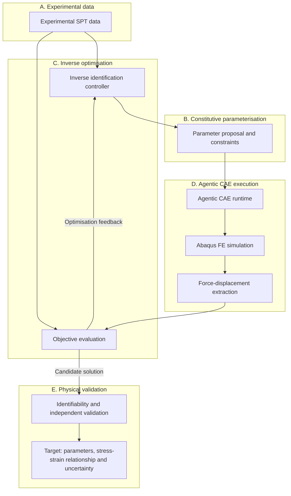
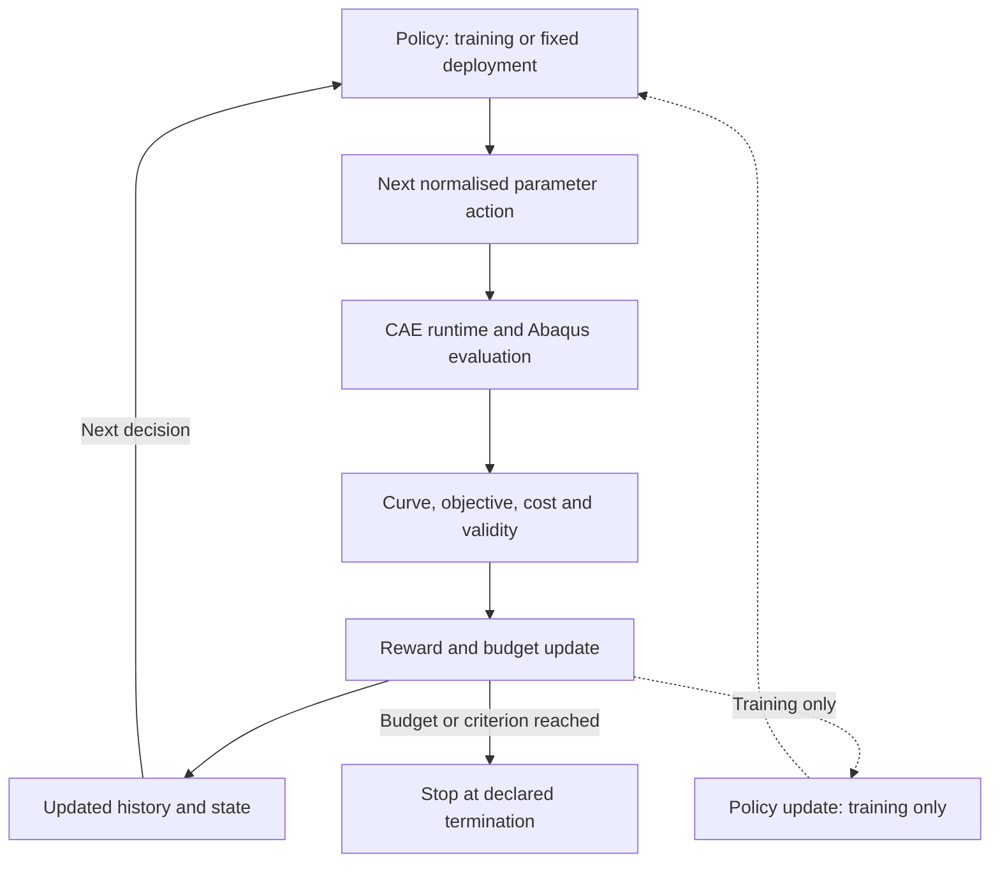

[English](README.md) | [简体中文](README.zh-CN.md)

# SP-InvOpt

**面向小冲杆试验本构参数反演的 Agentic CAE 与学习型方法**

SP-InvOpt（Small Punch Inverse Optimisation）是正在开发的科研框架，旨在利用实验小冲杆试验（SPT）力–位移曲线反演弹塑性本构参数。项目计划结合参数化 Abaqus 有限元仿真、自动化 CAE 执行、数值优化、代理模型与强化学习，研究兼顾计算效率与物理可信度的材料参数识别方法。

> 研究进行中，实验与数值验证尚未完成。仓库名称保持 **SMALL-PUNCH**。本项目尚不是经过验证的参数识别工具。

## 1. 项目概述

物理反演问题是项目的中心。Abaqus 是拟采用的高保真有限元正向求解器，Agentic CAE 是规划中的执行架构，数值优化提供不可缺少的基线。强化学习（RL）的价值需要通过与这些基线的对照实验来验证。

目前的产出是项目基础架构、环境与原始文件审计记录，以及研究文档。自动化反演、贝叶斯优化、代理模型、RL 和端到端 CAE 集成均**尚未实现**。

[研究概述](docs/Research_Overview.md) · [架构契约](docs/Research_Architecture.md) · [Run 索引](run/README.md) · [项目状态](status/PROJECT_STATUS.md)

## 2. 物理问题：小冲杆试验

典型小冲杆试验由薄圆片试样、中心球形或半球形压头，以及夹持/支承模具组成。施加压头位移，测量相应的反力或载荷。这是拟研究的物理问题描述；本项目实际几何和测量系统仍待确认。


*原创初始接触截面示意，不按实际比例绘制。轴向载荷传感器仅表示测力位置，不代表已核验的仪器布置。力箭头表示压头所受反力，施加位移方向向下。*

$$
F_{\mathrm{exp}}(u), \qquad
F_{\mathrm{FE}}(u)=\mathcal{M}(\theta,G,\mathrm{BC},\mu)(u)
$$

其中，$u$ 为压头位移，$F$ 为力，$\theta$ 为本构参数，$G$ 为几何及试样尺寸，$\mathrm{BC}$ 为边界条件，$\mu$ 为摩擦参数。

试验响应可能包括弹性变形、塑性弯曲、膜拉伸与接触非线性，在较大变形下还可能发生损伤或失效。是否纳入损伤和断裂，需要依据实际 CAE 模型与实验资料决定；本项目尚未实现或验证这类模型。压头形状、模具约束、摩擦和试样几何都会影响反演结果。

**仪器横梁位移不一定等于真实压头位移。** 试验机柔度、夹具变形和位移零点偏差可能引入系统误差，必须在比较实验与仿真曲线前明确其处理方法。

## 3. 研究目标

- 建立从实验数据到参数化有限元计算的可复现、可审计流程。
- 识别屈服强度与应变硬化指数，并保留参数接口的扩展能力。
- 在受控计算预算下比较网格搜索、差分进化和贝叶斯优化。
- 面向重复反演任务，研究代理模型辅助搜索与学习型序贯搜索。
- 在曲线拟合之外，评估参数可识别性、不确定性及独立的物理有效性。

目标是实现**高效、可靠、物理可信且可迁移的参数识别**。目前尚无识别精度或计算成本改善的实验证据。

## 4. 拟议研究架构

下图所有计算环节均为**规划**。末端节点表示预期研究产出，不代表已有结果。



CAE 层计划承担模型预检查、材料参数更新、作业调度、状态监控、ODB 结果提取、失败诊断和运行溯源/日志记录。物理验证还需要独立证据，仅凭优化闭环无法完成。

[AbqJobPilot](https://github.com/BrunelXian/AbqJobPilot) 是潜在的外部执行层，**尚未成为已集成依赖**。项目侧的 `preflight`、`enqueue`、`status`、`locate_outputs`、`extract_results` 和 `failure_diagnostics` 均为规划接口，尚未通过实际适配器核验。

Agentic CAE 不意味着让 LLM 直接控制 Abaqus GUI。项目优先采用可重复的参数化模型、明确的作业接口和结构化结果读取，并保留可用于诊断的失败记录。

## 5. 本构模型

研究初期拟采用 Hollomon 弹塑性关系：

$$
\sigma=K\varepsilon^n
$$

在与原始文献和 CAE 定义一致的前提下，候选连续分段形式为：

$$
\sigma(\varepsilon)=
\begin{cases}
E\varepsilon, & \varepsilon\leq\varepsilon_y,\\
E\varepsilon_y^{1-n}\varepsilon^n, & \varepsilon>\varepsilon_y,
\end{cases}
\qquad \varepsilon_y=\frac{\sigma_y}{E}
$$

$$
\theta=[\sigma_y,n], \qquad K=E\varepsilon_y^{1-n}
$$

$\sigma_y$ 为屈服强度，$n$ 为应变硬化指数，$E$ 为杨氏模量，$K$ 为强度系数。这里的 $K$ 由特定的屈服连续性约定导出，在该参数化方式中不是另一个独立自由参数。初期将 $E$ 视为已知输入，同时保留以后参与反演的接口。目前未批准具体材料数值或参数边界。

| 物理量 | 含义与区别 |
| --- | --- |
| 工程应力/应变 | 以试样初始尺寸为基准。 |
| 真实应力/应变 | 采用当前截面积；均匀单轴变形下的真实应变为对数伸长。 |
| 总应变 | 包含弹性与塑性贡献。 |
| 塑性应变 | 不含弹性贡献，不能与总应变混用。 |
| 等效塑性应变 | 由所选塑性模型定义的累积标量，不能用任意应变分量替代。 |

Abaqus 常规金属塑性表通常需要真实屈服应力与等效塑性应变，首点塑性应变为零。在小弹性应变的单轴标定条件下，塑性应变由真实总应变减去**当前**真实应力与 $E$ 的比值得到。不得将总应变直接输入 `*Plastic`。相关假设及版本限制见 [Abaqus 文档镜像](https://abaqus.uclouvain.be/English/SIMACAEGSARefMap/simagsa-c-matdefining.htm) 和[项目本构契约](docs/Constitutive_Model.md)。

**待解决问题（Open Questions）：** 原始 Hollomon 表达式采用的应变测度、它与后续 CAE 材料定义的一致性，以及此前登记的应变偏移差异尚未明确。扣除固定屈服应变不自动等同于扣除当前弹性应变。生成材料表前必须显式解决这些差异，不能擅自选择某一种来源约定。

## 6. 本构参数反演数学形式

在几何、边界条件和摩擦已明确，或被显式作为不确定量处理的条件下，初始反演问题写为：

$$
\theta^*=\operatorname*{arg\,min}_{\theta\in\Theta}\mathcal{L}(\theta),
\qquad
\mathcal{L}(\theta)=\sum_i w_i
\left[F_{\mathrm{FE}}(u_i;\theta)-F_{\mathrm{exp}}(u_i)\right]^2
$$

$\Theta$ 为物理允许参数集合，$w_i\geq0$ 为比较权重。后续可加入归一化、正则化、参数约束及不确定性评估，但具体定义仍需选择并记录。

实验与有限元曲线必须在统一位移坐标和合理的重叠区间内比较。对齐、插值、加载/卸载分支、实验噪声、位移零点、试验机柔度、接触条件和几何不确定性均需一致处理。不能把这些干扰因素的影响默默吸收到材料参数中。

**力–位移曲线吻合良好，并不自动保证本构参数唯一或物理正确。** 不同参数组合或建模假设可能产生近似等价的曲线。

## 7. 强化学习在项目中的角色

拟研究方向为**计算预算约束下的序贯本构参数识别（Budget-Aware Sequential Constitutive Parameter Identification）**：在有限 Abaqus 计算预算内，学习如何选择下一次有限元评估的位置。

RL Agent 提出下一组材料参数，CAE Runtime 负责可靠执行对应计算并返回结构化证据。RL 不改变力学控制方程，也不替代 Abaqus 求解器。

网格搜索（Grid Search）、差分进化（Differential Evolution）和贝叶斯优化（Bayesian Optimisation）是必须建立的初始基线。PPO、SAC 及其他适用的序贯决策方法是后续候选，其适用性尚未确认。对于只有两个参数的单次反演，传统优化可能更高效。

RL 的潜在价值主要来自重复反演任务、跨材料迁移、学习型序贯搜索策略、有限 FE 预算及代理模型辅助探索。这些是研究假设，不是已取得的收益。**不预设 RL 优于贝叶斯优化。**

拟议闭环明确区分有限元评估、奖励/状态更新与策略训练。虚线仅适用于训练阶段，推理部署可使用固定策略。图中流程均尚未实现。



## 8. MDP 数学定义

以下是针对固定反演任务的拟议建模方式，不代表已实现或验证的环境。

### 状态

$$
s_t=\left(\mathcal{D}_t,\theta_{\mathrm{best},t},\mathcal{L}_{\mathrm{best},t},B_t\right)
$$

$\mathcal{D}_t$ 包含已完成的参数–CAE 评估记录，包括目标值、成本和有效性/失败信息。其余分量依次为当前最优有效参数、最优有效损失和剩余计算预算。在尚无有效最优解时，需要明确的初始化状态标识。

不能假定不断增长的数据集可以直接作为固定维度策略网络的输入。未来可采用固定维度特征、历史编码器、集合编码器或代理模型摘要。跨任务策略还需要实验与模型上下文；压缩表示是否保留足以构成马尔可夫状态的信息，需要进一步评估。

### 动作

$$
a_t=\theta_{t+1}
\quad\text{or}\quad
a_t=\Delta\theta_t
$$

动作可以选择完整参数向量，也可以给出局部参数更新。物理参数存在量纲与尺度差异，策略优化宜使用归一化动作空间，并明确映射到物理允许边界的方式。边界与映射目前均未实现。

### 奖励

$$
r_t=\mathcal{L}_{\mathrm{best},t}-\mathcal{L}_{\mathrm{best},t+1}-\lambda_c C_t
$$

这是初始奖励设计：最优有效损失的改善量减去计算成本惩罚。$C_t$ 表示实际 CAE 评估成本，需声明单位或归一化方式，$\lambda_c$ 控制权衡。损失和成本的尺度应一起定义。该奖励要求已有有效最优解，初始化与失败情形需要单独规则。

### 状态转移与终止

一次 Abaqus 评估结束后，更新已评估参数集合、目标值/有效性记录、当前最优有效解及剩余预算。若预算按调用次数计，每次尝试扣除规定次数；若预算按时间计，则扣除实测时间。失败评估同样消耗实际资源。

当 FE 评估预算耗尽、达到约定目标阈值，或满足声明的数值终止条件时结束。达到目标阈值并不能证明物理有效性。

失败或无效求解必须有明确的失败状态与惩罚/成本规则，不能产生虚构的低损失或正改善奖励。超时、重试和终止策略应避免 Agent 利用异常求解行为获取错误收益。

**RL 训练成本与推理部署阶段的 FE 评估成本必须分别报告。** 训练数据生成、代理模型拟合、策略训练及调参均计入总成本。跨任务摊销是否有优势，需要实测证据和独立留出任务评估。

## 9. 研究问题

| 研究问题 | 重点与评价指标 |
| --- | --- |
| **RQ1 — 计算效率：** 学习型序贯优化能否减少本构参数识别所需的高保真有限元评估次数？ | FE 评估次数、实际耗时、最优目标值、成功率，以及训练与部署总成本。 |
| **RQ2 — 参数可识别性：** 小冲杆试验响应能够在多大程度上唯一、稳健地识别屈服强度和应变硬化指数？ | 敏感性、参数相关性、实验噪声、接触不确定性、置信区域及多个近似等价解。 |
| **RQ3 — 泛化与迁移能力：** 学习得到的优化策略能否迁移到不同材料、参数范围、几何或实验条件？ | 留出材料、未见参数组合、试验条件变化、跨任务迁移及分布外行为。 |

各方法应使用一致的 FE 预算、数据划分、目标定义与终止规则，并报告重复试验及失败情况。数值拟合与独立物理验证必须明确区分。

## 10. 研究路线图

使用 **Completed（已完成）**、**In Progress（进行中）**、**Planned（规划中）**、**Blocked（受阻）** 描述实际进展。完成文件审计不等于完成 CAE 验证。

| 阶段 | 工作范围 | 状态 |
| --- | --- | --- |
| **1 — 基础架构与 CAE 合理性检查** | 项目结构、原始文件盘点、环境检查和研究文档；基准 CAE 验证与力–位移提取。 | **In Progress**。基础架构/文档：**Completed with warnings**。基准 CAE 验证和曲线提取：**Blocked**，需先取得可审计模型并澄清数据/本构定义。 |
| **2 — 自动化本构参数反演** | Hollomon 参数化、目标函数、网格搜索、差分进化和贝叶斯优化。 | **Planned**；依赖 Stage 1 已验证输入。 |
| **3 — 代理模型与学习型优化** | FE 数据集、代理模型、RL 环境、PPO/SAC 可行性及相同预算下的基准比较。 | **Planned**。 |
| **4 — 物理验证与论文** | 参数可识别性、实验不确定性、独立材料验证、泛化、消融研究及论文撰写。 | **Planned**；不宣称已有论文或验证成果。 |

## 11. 仓库结构

以下目录已存在于本地。研究模块目录目前用于预留结构，目录存在不意味着功能已实现或模型已就绪。

```text
SMALL-PUNCH/
├── AGENTS.md
├── README.md
├── README.zh-CN.md
├── .gitignore
├── docs/                  # 研究文档与技术契约
│   └── figures/           # 原创科研 SVG 示意图
├── status/                # 项目状态
├── CAE/
│   ├── Models/            # 模型源/工作副本与生成模型
│   └── Scripts/           # 未来的参数化与结果提取脚本
├── experiments/           # 通过明确流程导入的研究数据
├── inverse/               # 未来的本构参数反演代码
├── run/
│   ├── README.md          # Run 索引
│   ├── run_001/           # 基础架构与审计记录
│   └── run_002/           # 双语研究主页文档
├── tests/                 # 轻量基础架构检查
└── references_private/    # 不可修改原件；Git 忽略，仅本地保存
```

CAE 工作模型统一放入 `CAE/`，私有原件保持不动。`CAE/Jobs/` 是**规划中**且已设忽略规则的求解工作目录，目前尚不存在。每次独立研究执行使用 `run/run_XXX/`，至少包含 `run.json`、`summary.md`、`artifacts/` 和 `checkpoints/`。产物优先通过可追溯的仓库相对路径引用实际文件，避免重复存放大型文件。详见[文件通信协议](docs/Agent_File_Communication_Protocol.md)。

## 12. 计算环境

run_001 于 **2026-10-10** 核验了外部 **Python 3.11.13** 环境，包括 NumPy、SciPy、Pandas、Matplotlib、scikit-learn，以及可选 PyTorch/RL 依赖 PyTorch、Gymnasium、Stable-Baselines3。8 个包均成功导入。这是本机已观测环境，不是可移植依赖锁或安装保证。

**Abaqus 2024** release 查询和内置 **Python 3.10.5** 查询成功。尚未测试许可证签出、CAE 启动或 Solver 执行。外部研究 Python 与 Abaqus Python 必须分进程运行，通过结构化文件交换信息；不能假定 Abaqus Python 可导入外部科学计算或机器学习包。本机解释器路径保留在本地开发/运行记录中，不作为公开安装要求。

目前没有提供安装器或可执行的反演流水线。已观测具体版本见[环境审计](run/run_001/artifacts/environment.json)。本次文档任务未安装新依赖。

## 13. 当前项目状态

截至 **2026-10-10**，以下状态依据 run_001 证据及 run_002 文档更新：

| 领域 | 有证据支持的状态 |
| --- | --- |
| 项目基础架构 | 已完成但存在未决项；**run_001 = WARNING**。 |
| 原始研究文件 | 5 个文件私有保存，迁移前后 SHA-256 一致。 |
| Python 环境 | 已核验版本及 8 个包的实际导入。 |
| Abaqus 安装 | release 和 Python 查询已核验；求解/许可证能力未测试。 |
| 轻量基础检查 | 17 项通过，不代表数值或物理验证。 |
| CAE 模型审计 | 待处理/未解决，尚无确认可审计的模型输入。 |
| 实验曲线验证 | 待处理，尚无已验证的 SPT 力–位移数据集。 |
| 本构定义 | 生成材料表前需澄清。 |
| 自动化反演/代理模型/RL | 尚未实现。 |
| Agentic CAE / AbqJobPilot 集成 | 规划中，尚未集成或验证。 |
| 研究主页 | 中英文文档已编写；因与既有改动混合，未 commit 或 push，run_002 保持 **WARNING**。 |

详见 [run_001](run/run_001/summary.md)、[run_002](run/run_002/summary.md) 和[项目状态](status/PROJECT_STATUS.md)。本仓库不宣称已有参数识别基准结果或经过实验验证的材料成果。

## 14. 可复现性与数据政策

`references_private/` 是不可修改且被 Git 忽略的原始资料区，绝不能作为 Abaqus 工作目录。历史目录名 `materials/` 和 `Materials/` 继续保留忽略规则。私有原件、敏感测量数据及详细本地来源记录不写入本 README，也不在本次任务中上传。

研究数据进入 `experiments/`、模型工作副本进入 `CAE/`，必须经过明确的导入/预处理流程，保留来源标识、SHA-256、转换设置、单位、版本及输出溯源。导入不自动赋予公开权限。ODB、SIM、LCK 和求解中间文件不得提交。

Run 记录保存 Git HEAD、输入、输出、验证、错误及可确定时间。本框架旨在支持可审计研究流程，但由于尚缺经过验证的模型与实验输入，**目前无法仅凭本仓库复现科学结果**。详见[数据管理](docs/Data_Management.md)。

## 15. 研究局限与边界

1. 单条 SPT 力–位移曲线可能不足以唯一识别全部本构参数。
2. 摩擦、压头/模具几何、试样尺寸和试验机柔度均可能影响反演结果。
3. 本构参数识别依赖所选有限元正向模型及其假设。
4. Hollomon 未必适用于所有应变硬化区间；损伤/断裂需要单独论证。
5. 优秀的有限元曲线拟合不能证明材料模型有效。
6. RL 优越性需要受控对照实验验证，并计入训练和部署成本。
7. 物理验证和参数可识别性必须独立于数值拟合质量进行评估。

## 16. 引用与联系

本仓库尚未确立关联论文、DOI 或正式引用格式。在此之前，请引用仓库链接及所使用的具体修订版本；不编造作者名单或 BibTeX。

仓库与项目联系入口：[SHUAIXSYU/SMALL-PUNCH](https://github.com/SHUAIXSYU/SMALL-PUNCH)。公开问题可使用仓库可用的讨论/Issue 渠道，请勿发布私有研究数据。
