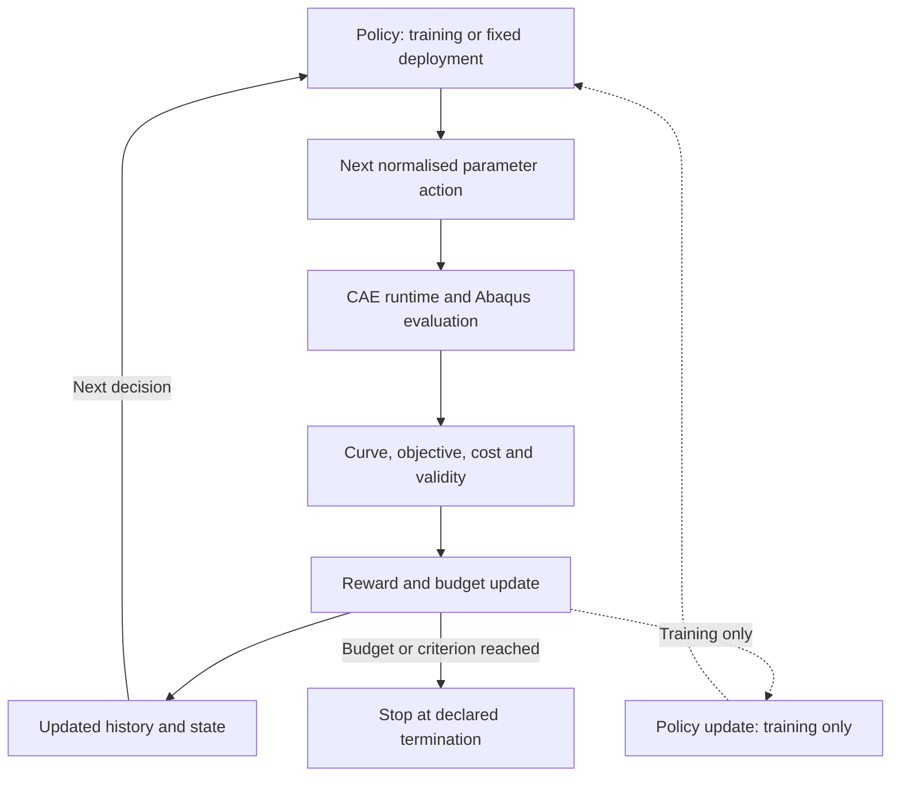

[English](Inverse_Identification.md) | [简体中文](Inverse_Identification.zh-CN.md)

# Inverse Identification: Constitutive Model, RL and Validation

[Back to the project](../README.md). This is a proposed research contract, not implemented software or validated results.

## Constitutive Model

The initial candidate is a Hollomon elastoplastic relation:

$$
\sigma=K\varepsilon^n
$$

A candidate continuous piecewise form, conditional on agreement with the source literature and CAE definition, is:

$$
\sigma(\varepsilon)=
\begin{cases}
E\varepsilon, & \varepsilon\leq\varepsilon_y,\\
E\varepsilon_y^{1-n}\varepsilon^n, & \varepsilon>\varepsilon_y,
\end{cases}
\qquad \varepsilon_y=\frac{\sigma_y}{E}
$$

$$
\theta=[\sigma_y,n], \qquad K=E\varepsilon_y^{1-n}
$$

$\sigma_y$ is yield strength, $n$ the strain-hardening exponent, $E$ Young's modulus and $K$ the strength coefficient. The expression for $K$ follows from this particular continuity convention; it is not a separate free parameter in that parameterisation. Initially, $E$ is treated as known, with an interface for later inference. No numerical material values or parameter bounds are approved here.

| Quantity | Meaning and distinction |
| --- | --- |
| Engineering stress / strain | Based on initial specimen dimensions. |
| True stress / strain | Based on current area and, for uniform uniaxial strain, logarithmic stretch. |
| Total strain | Includes elastic and plastic contributions. |
| Plastic strain | Excludes the elastic contribution; not interchangeable with total strain. |
| Equivalent plastic strain | Accumulated scalar measure under the chosen plasticity model; not an arbitrary strain component. |

Conventional Abaqus metal plasticity tables typically require true yield stress versus equivalent plastic strain, starting at zero plastic strain. In uniaxial calibration with small elastic strains, plastic strain is obtained by subtracting the **current** true stress divided by $E$ from true total strain. Do not pass total strain directly to `*Plastic`. See the [Abaqus documentation mirror](https://abaqus.uclouvain.be/English/SIMACAEGSARefMap/simagsa-c-matdefining.htm) and the [project constitutive contract](Constitutive_Model.md) for assumptions and version limitations.

**Open questions:** the strain measure used in the source Hollomon expression, its consistency with the eventual CAE material definition, and a previously recorded strain-offset discrepancy remain unresolved. A fixed yield-strain offset is not automatically equivalent to subtracting the current elastic strain. These differences must be resolved explicitly before generating material tables; no source convention is silently selected.

## Inverse Identification Formulation

With geometry, boundary conditions and friction specified or explicitly treated as uncertain, the initial inverse problem is:

$$
\theta^*=\operatorname*{arg\,min}_{\theta\in\Theta}\mathcal{L}(\theta),
\qquad
\mathcal{L}(\theta)=\sum_i w_i
\left[F_{\mathrm{FE}}(u_i;\theta)-F_{\mathrm{exp}}(u_i)\right]^2
$$

$\Theta$ denotes admissible physical parameters and $w_i\geq0$ the comparison weights. Normalisation, regularisation, parameter constraints and uncertainty assessment are possible extensions; their definitions remain to be chosen and recorded.

Experimental and FE curves must be compared on a common displacement coordinate and a justified overlapping interval. Alignment, interpolation, loading/unloading branches, experimental noise, displacement offset, machine compliance, contact conditions and geometric uncertainty must be considered consistently. Nuisance parameters cannot be silently absorbed into material parameters.

**Good force–displacement agreement does not automatically guarantee unique or physically correct constitutive parameters.** Several parameter sets or modelling assumptions may produce near-equivalent curves.

## Role of Reinforcement Learning

The proposed direction is **Budget-Aware Sequential Constitutive Parameter Identification**: learn where to spend the next FE evaluation within a limited Abaqus budget.

The RL agent proposes the next material parameter location. The CAE runtime executes that evaluation reliably and returns structured evidence. RL does not modify the governing mechanics or replace the Abaqus solver.

Grid Search, Differential Evolution and Bayesian Optimisation are the required initial baselines. PPO, SAC and other suitable sequential decision-making methods are later candidates; their applicability has not been established. For a single inverse problem with only two parameters, conventional optimisation may be more efficient.

Potential value is expected primarily in repeated identification tasks, cross-material transfer, learned sequential search policies, limited FE budgets and surrogate-assisted exploration. These are hypotheses, not reported benefits. **RL is not assumed to outperform Bayesian Optimisation.**

The proposed loop separates FE evaluation, reward/state updates and policy training. Dashed links apply only during training; inference can use a fixed policy. No part of this loop has been implemented.

## MDP Formulation

The following is a proposed formulation for a fixed identification task, not an implemented or validated environment.

### State

$$
s_t=\left(\mathcal{D}_t,\theta_{\mathrm{best},t},\mathcal{L}_{\mathrm{best},t},B_t\right)
$$

$\mathcal{D}_t$ contains completed parameter–CAE evaluations, including objective values, costs and validity/failure information. The remaining terms are the best valid parameters, best valid loss and remaining computational budget. Before a valid incumbent exists, the state needs an explicit initialisation indicator.

The growing dataset cannot be assumed to fit a fixed-dimensional policy input. Future options include fixed-dimensional features, history or set encoders, or a surrogate-based summary. Cross-task policies also need experiment and model context. Whether a compressed representation retains sufficient information for a Markov formulation must be assessed.

### Action

$$
a_t=\theta_{t+1}
\quad\text{or}\quad
a_t=\Delta\theta_t
$$

An action selects a complete parameter vector or a local update. Physical parameters have different units and scales, so policy optimisation should use a normalised action space with an explicit mapping to admissible physical bounds. Neither bounds nor mapping are implemented yet.

### Reward

$$
r_t=\mathcal{L}_{\mathrm{best},t}-\mathcal{L}_{\mathrm{best},t+1}-\lambda_c C_t
$$

This is an initial reward proposal: improvement in best valid loss minus a computational-cost penalty. $C_t$ represents actual CAE evaluation cost, with declared units/normalisation, and $\lambda_c$ sets the trade-off. Loss scaling and cost scaling must be defined together. The reward requires a valid incumbent; initialisation and failure handling need separate rules.

### Transition and termination

After an Abaqus evaluation, update the evaluated parameter set, objective/validity record, best-known valid solution and remaining budget. For a call-count budget, each attempted evaluation consumes a declared count; for a time budget, debit measured time. Failed evaluations must also consume their actual resources.

Terminate when the FE evaluation budget is exhausted, an agreed objective threshold is reached, or declared numerical termination criteria are met. Reaching an objective threshold is not proof of physical validity.

Failed or invalid solves need an explicit failure state and penalty/cost rule. They must never yield a fabricated low loss or positive improvement reward. Timeout, retry and termination policies must prevent exploiting exceptional solver behaviour.

**RL training cost and inference-time FE evaluation cost must be reported separately.** Training data generation, surrogate fitting, policy training and tuning contribute to total cost. Any advantage from amortisation across tasks requires measured evidence and held-out evaluation.

## Research Questions

| Question | Focus and evaluation |
| --- | --- |
| **RQ1 — Computational Efficiency:** Can learning-based sequential optimisation reduce the number of high-fidelity FE evaluations required for identification? | FE evaluations, wall-clock time, best objective, success rate, and total training plus deployment cost. |
| **RQ2 — Parameter Identifiability:** To what extent can yield strength and strain-hardening exponent be uniquely and robustly identified from SPT responses? | Sensitivity, parameter correlation, experimental noise, contact uncertainty, confidence regions and multiple near-equivalent solutions. |
| **RQ3 — Generalisation and Transferability:** Can a learned optimisation strategy transfer across materials, parameter ranges, geometries or experimental conditions? | Held-out materials, unseen parameter combinations, changed test conditions, cross-task transfer and out-of-distribution behaviour. |

Comparisons should share FE budgets, data splits, objective definitions and termination rules, with repeated trials and reported failures. Numerical fitting and independent physical validation must remain distinct.

## Evaluation safeguards

Split training, validation and test tasks by source experiment/material, not by simulated variants of the same experimental curve. Keep held-out tasks independent. Report failed evaluations, compute resources and total training/deployment cost under the same comparison budget.

Use an independent material test or additional experimental conditions when available. If independent stress–strain measurements are unavailable, state the limited validation scope. For data extending into damage or fracture, justify a restricted fit interval or an independently validated additional model; do not force an elastoplastic law to explain failure.
