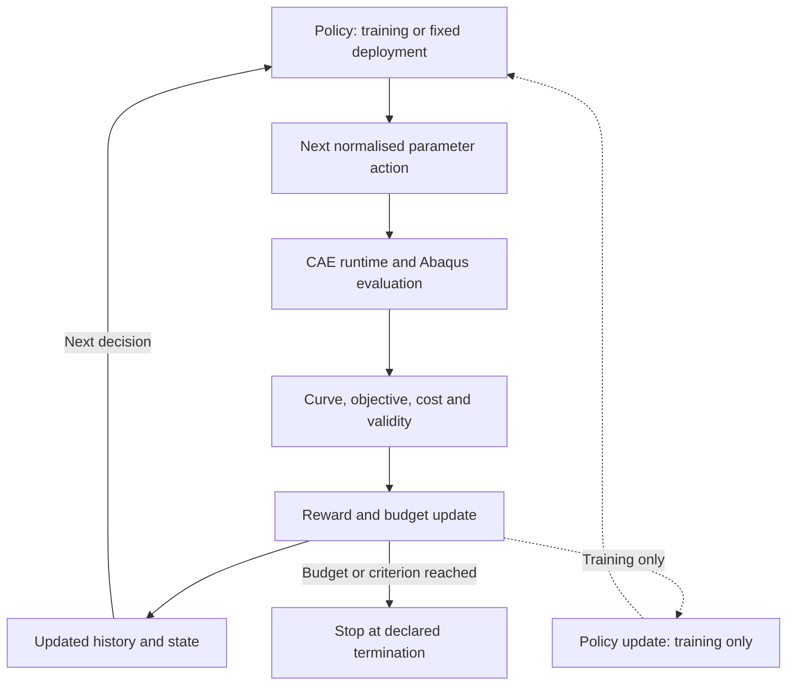

[English](Inverse_Identification.md) | [简体中文](Inverse_Identification.zh-CN.md)

# 本构参数反演：材料模型、RL 与验证

[返回项目首页](../README.zh-CN.md)。本文为拟议研究契约，不代表已经实现的软件或已验证成果。

## 本构模型

研究初期拟采用 Hollomon 弹塑性关系：

$$
\sigma=K\varepsilon^n
$$

在与原始文献和 CAE 定义一致的前提下，候选连续分段形式为：

$$
\sigma(\varepsilon)=
\begin{cases}
E\varepsilon, & \varepsilon\leq\varepsilon_y,\\
E\varepsilon_y^{1-n}\varepsilon^n, & \varepsilon>\varepsilon_y,
\end{cases}
\qquad \varepsilon_y=\frac{\sigma_y}{E}
$$

$$
\theta=[\sigma_y,n], \qquad K=E\varepsilon_y^{1-n}
$$

$\sigma_y$ 为屈服强度，$n$ 为应变硬化指数，$E$ 为杨氏模量，$K$ 为强度系数。这里的 $K$ 由特定的屈服连续性约定导出，在该参数化方式中不是另一个独立自由参数。初期将 $E$ 视为已知输入，同时保留以后参与反演的接口。目前未批准具体材料数值或参数边界。

| 物理量 | 含义与区别 |
| --- | --- |
| 工程应力/应变 | 以试样初始尺寸为基准。 |
| 真实应力/应变 | 采用当前截面积；均匀单轴变形下的真实应变为对数伸长。 |
| 总应变 | 包含弹性与塑性贡献。 |
| 塑性应变 | 不含弹性贡献，不能与总应变混用。 |
| 等效塑性应变 | 由所选塑性模型定义的累积标量，不能用任意应变分量替代。 |

Abaqus 常规金属塑性表通常需要真实屈服应力与等效塑性应变，首点塑性应变为零。在小弹性应变的单轴标定条件下，塑性应变由真实总应变减去**当前**真实应力与 $E$ 的比值得到。不得将总应变直接输入 `*Plastic`。相关假设及版本限制见 [Abaqus 文档镜像](https://abaqus.uclouvain.be/English/SIMACAEGSARefMap/simagsa-c-matdefining.htm) 和[项目本构契约](Constitutive_Model.md)。

**待解决问题（Open Questions）：** 原始 Hollomon 表达式采用的应变测度、它与后续 CAE 材料定义的一致性，以及此前登记的应变偏移差异尚未明确。扣除固定屈服应变不自动等同于扣除当前弹性应变。生成材料表前必须显式解决这些差异，不能擅自选择某一种来源约定。

## 本构参数反演数学形式

在几何、边界条件和摩擦已明确，或被显式作为不确定量处理的条件下，初始反演问题写为：

$$
\theta^*=\operatorname*{arg\,min}_{\theta\in\Theta}\mathcal{L}(\theta),
\qquad
\mathcal{L}(\theta)=\sum_i w_i
\left[F_{\mathrm{FE}}(u_i;\theta)-F_{\mathrm{exp}}(u_i)\right]^2
$$

$\Theta$ 为物理允许参数集合，$w_i\geq0$ 为比较权重。后续可加入归一化、正则化、参数约束及不确定性评估，但具体定义仍需选择并记录。

实验与有限元曲线必须在统一位移坐标和合理的重叠区间内比较。对齐、插值、加载/卸载分支、实验噪声、位移零点、试验机柔度、接触条件和几何不确定性均需一致处理。不能把这些干扰因素的影响默默吸收到材料参数中。

**力–位移曲线吻合良好，并不自动保证本构参数唯一或物理正确。** 不同参数组合或建模假设可能产生近似等价的曲线。

## 强化学习在项目中的角色

拟研究方向为**计算预算约束下的序贯本构参数识别（Budget-Aware Sequential Constitutive Parameter Identification）**：在有限 Abaqus 计算预算内，学习如何选择下一次有限元评估的位置。

RL Agent 提出下一组材料参数，CAE Runtime 负责可靠执行对应计算并返回结构化证据。RL 不改变力学控制方程，也不替代 Abaqus 求解器。

网格搜索（Grid Search）、差分进化（Differential Evolution）和贝叶斯优化（Bayesian Optimisation）是必须建立的初始基线。PPO、SAC 及其他适用的序贯决策方法是后续候选，其适用性尚未确认。对于只有两个参数的单次反演，传统优化可能更高效。

RL 的潜在价值主要来自重复反演任务、跨材料迁移、学习型序贯搜索策略、有限 FE 预算及代理模型辅助探索。这些是研究假设，不是已取得的收益。**不预设 RL 优于贝叶斯优化。**

拟议闭环明确区分有限元评估、奖励/状态更新与策略训练。虚线仅适用于训练阶段，推理部署可使用固定策略。图中流程均尚未实现。

## MDP 数学定义

以下是针对固定反演任务的拟议建模方式，不代表已实现或验证的环境。

### 状态

$$
s_t=\left(\mathcal{D}_t,\theta_{\mathrm{best},t},\mathcal{L}_{\mathrm{best},t},B_t\right)
$$

$\mathcal{D}_t$ 包含已完成的参数–CAE 评估记录，包括目标值、成本和有效性/失败信息。其余分量依次为当前最优有效参数、最优有效损失和剩余计算预算。在尚无有效最优解时，需要明确的初始化状态标识。

不能假定不断增长的数据集可以直接作为固定维度策略网络的输入。未来可采用固定维度特征、历史编码器、集合编码器或代理模型摘要。跨任务策略还需要实验与模型上下文；压缩表示是否保留足以构成马尔可夫状态的信息，需要进一步评估。

### 动作

$$
a_t=\theta_{t+1}
\quad\text{or}\quad
a_t=\Delta\theta_t
$$

动作可以选择完整参数向量，也可以给出局部参数更新。物理参数存在量纲与尺度差异，策略优化宜使用归一化动作空间，并明确映射到物理允许边界的方式。边界与映射目前均未实现。

### 奖励

$$
r_t=\mathcal{L}_{\mathrm{best},t}-\mathcal{L}_{\mathrm{best},t+1}-\lambda_c C_t
$$

这是初始奖励设计：最优有效损失的改善量减去计算成本惩罚。$C_t$ 表示实际 CAE 评估成本，需声明单位或归一化方式，$\lambda_c$ 控制权衡。损失和成本的尺度应一起定义。该奖励要求已有有效最优解，初始化与失败情形需要单独规则。

### 状态转移与终止

一次 Abaqus 评估结束后，更新已评估参数集合、目标值/有效性记录、当前最优有效解及剩余预算。若预算按调用次数计，每次尝试扣除规定次数；若预算按时间计，则扣除实测时间。失败评估同样消耗实际资源。

当 FE 评估预算耗尽、达到约定目标阈值，或满足声明的数值终止条件时结束。达到目标阈值并不能证明物理有效性。

失败或无效求解必须有明确的失败状态与惩罚/成本规则，不能产生虚构的低损失或正改善奖励。超时、重试和终止策略应避免 Agent 利用异常求解行为获取错误收益。

**RL 训练成本与推理部署阶段的 FE 评估成本必须分别报告。** 训练数据生成、代理模型拟合、策略训练及调参均计入总成本。跨任务摊销是否有优势，需要实测证据和独立留出任务评估。

## 研究问题

| 研究问题 | 重点与评价指标 |
| --- | --- |
| **RQ1 — 计算效率：** 学习型序贯优化能否减少本构参数识别所需的高保真有限元评估次数？ | FE 评估次数、实际耗时、最优目标值、成功率，以及训练与部署总成本。 |
| **RQ2 — 参数可识别性：** 小冲杆试验响应能够在多大程度上唯一、稳健地识别屈服强度和应变硬化指数？ | 敏感性、参数相关性、实验噪声、接触不确定性、置信区域及多个近似等价解。 |
| **RQ3 — 泛化与迁移能力：** 学习得到的优化策略能否迁移到不同材料、参数范围、几何或实验条件？ | 留出材料、未见参数组合、试验条件变化、跨任务迁移及分布外行为。 |

各方法应使用一致的 FE 预算、数据划分、目标定义与终止规则，并报告重复试验及失败情况。数值拟合与独立物理验证必须明确区分。

## 评价方案的约束

按原始实验/材料划分训练、验证和测试任务，避免将同一实验曲线的仿真变体分到独立测试集。留出任务必须保持独立。在相同预算下报告失败评估、计算资源和完整训练/部署成本。

条件允许时采用独立材料测试或额外实验工况验证。若无法获得独立应力–应变测量，明确说明验证范围的限制。数据涉及损伤或断裂时，应论证限定拟合区间，或采用另行验证的附加模型；不能强行用纯弹塑性关系解释失效。
