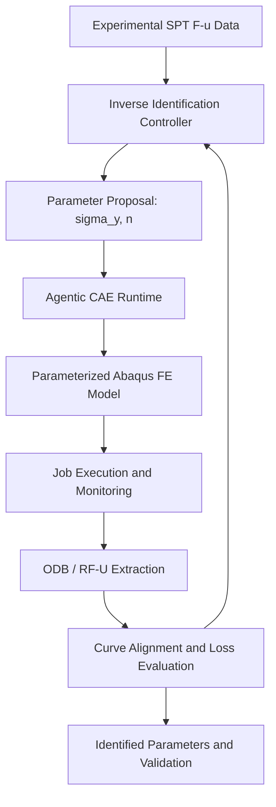

# SP-InvOpt — 项目启动与研究交接文档

> **项目名称**：SP-InvOpt — Small Punch Inverse Optimisation  
> **GitHub 仓库**：[SHUAIXSYU/SMALL-PUNCH](https://github.com/SHUAIXSYU/SMALL-PUNCH)  
> **本地项目路径**：`E:\Projects\SMALL-PUNCH`  
> **文档性质**：项目启动基准、研究边界与后续 Agent 交接资料  
> **更新基准**：2026-10-11；以已收到的 `run_001` 摘要为已核验进度。`run_002` README 工作尚无完成回报，不能视为已完成。

## 1. 项目定位与结论

本项目利用**小冲杆试验（Small Punch Test, SPT）的实验力–位移曲线**，通过 **Abaqus 正向有限元模型 + 自动化 CAE 执行 + 数值优化**反向识别材料弹塑性本构参数，并在可信基线之上研究 **surrogate-assisted optimisation** 与 **reinforcement learning (RL)** 对重复反演任务的效率和泛化价值。

**核心判断**：优先建立可复现的正向 CAE 与传统反演基线；Agentic CAE 是可靠执行层，RL 是待验证的算法研究问题，不能预设优于差分进化或贝叶斯优化。论文贡献应围绕**效率、参数可识别性、物理可信度和迁移泛化**展开，而非仅把人工调参换成自动运行。

### 研究目标

- 从 SPT 实验的 $F_{\mathrm{exp}}(u)$ 识别 Hollomon 本构模型的初始参数 $\boldsymbol\theta=(\sigma_y,n)$；弹性模量 $E$ 先作为已知量，保留扩展。
- 以可审计的参数化 Abaqus 求解产生 $F_{\mathrm{FE}}(u;\boldsymbol\theta)$，构建自动反演闭环。
- 比较 Grid Search、Differential Evolution（DE）、Bayesian Optimisation（BO）与条件成熟后引入的 RL。
- 评估参数唯一性、观测噪声、摩擦/几何/夹具等不确定性，以及独立实验验证。

## 2. 物理问题：Small Punch Test

研究对象为受约束的**圆形薄片试样**，中央由**球形或半球形压头**向下加载，试验记录载荷及位移。实际设备的几何、夹持方式、接触状态与位移测量基准，均必须由原始 CAE 与实验记录核实。

SPT 过程可能涉及弹性变形、局部弯曲、接触非线性、塑性流动与膜拉伸。若实验延伸至损伤或断裂区，单一 Hollomon 弹塑性模型可能不足以完整描述，须限定反演拟合区间或引入经验证的额外模型。

特别注意：**横梁位移不必然等于压头相对于试样的真实位移**；设备柔度、零点校正、摩擦系数和试样厚度会对反演产生系统性影响。

### 建议制作的项目图件

1. `docs/figures/spt_setup.svg`：原创 SPT 轴对称截面示意（压头、薄片、模具、加载方向）。
2. README Mermaid：实验 → 反演控制器 → Agentic CAE → Abaqus → 力–位移曲线 → 损失评估的计算闭环。
3. README Mermaid：RL 状态、动作、CAE 评估、奖励及状态更新的序贯决策闭环。

不要从论文直接复制没有明确授权的图片；不得使用虚构的实验曲线作为实际结果。

## 3. Hollomon 本构模型与 Abaqus 输入

初期研究采用分段弹塑性 Hollomon 表达式（**仅作为候选建模契约，最终以原始文献和现有模型的应变定义核实为准**）：

$$
\sigma = \begin{cases}
E\varepsilon, & \varepsilon\leq\varepsilon_y,\\
E\varepsilon_y^{1-n}\varepsilon^n, & \varepsilon>\varepsilon_y,
\end{cases}
\qquad \varepsilon_y=\frac{\sigma_y}{E}.
$$

- $E$：Young's modulus；$\sigma_y$：初始屈服强度；$n$：应变硬化指数。
- 参数初始空间：$\boldsymbol\theta=[\sigma_y,n]$，实际搜索上下界应由材料知识与实验资料确定，不能凭空固定。
- **必须区分工程应力/应变、真应力/应变、总应变与（等效）塑性应变**。
- Abaqus 常规金属 `*Plastic` 表格要求屈服真应力与等效塑性应变；**不能直接把 Hollomon 总应变当作塑性应变输入**。对于单轴等向硬化表征，需从选定的真应力–总真应变关系正确换算塑性应变并检查单调性、连续性与物理合理性。
- 现有文献公式和 CAE 实际材料定义之间如有差异，应保留未决状态，先审计、后修改。

## 4. 反演数学问题

设 $G$ 为几何参数，$BC$ 为边界/夹持条件，$\mu$ 为摩擦系数，则正向模型为：

$$
F_{\mathrm{FE}}(u;\boldsymbol\theta,G,BC,\mu)=\mathcal M(\boldsymbol\theta,G,BC,\mu).
$$

基础目标函数：

$$
\boldsymbol\theta^*=\underset{\boldsymbol\theta\in\Omega}{\arg\min}\;\mathcal L(\boldsymbol\theta),
\qquad
\mathcal L(\boldsymbol\theta)=\sum_{i=1}^{N}w_i\left[F_{\mathrm{FE}}(u_i;\boldsymbol\theta)-F_{\mathrm{exp}}(u_i)\right]^2.
$$

**必要处理**：单位统一、位移零点/设备柔度审查、实验与数值曲线按一致位移轴插值、拟合区间定义、对不同载荷区间的合理加权、求解失败惩罚与物理参数约束。归一化损失和正则化可作为后续对照。

**科学边界**：拟合误差很低只说明给定模型可以拟合观测，不必然证明材料参数真实或唯一；必须使用敏感性分析、参数置信区域或多工况/独立实验加以判断。

## 5. 建议的 Agentic CAE 架构



分层原则：

| 层级 | 职责 | 阶段定位 |
|---|---|---|
| Experimental Data | 实验曲线、元数据、测量不确定性 | 原始数据需审计 |
| Parameterisation | Hollomon 参数到 Abaqus 材料输入 | 待实现 |
| Inverse Controller | Grid/DE/BO/RL 候选参数选择与终止条件 | 待实现 |
| Agentic CAE Runtime | Preflight、作业提交、监控、提取、失败诊断、日志 | 拟复用 AbqJobPilot，尚未确认集成 |
| Physical Validation | 反演结果、独立实验、敏感性、泛化 | 待设计和验证 |

推荐使用独立的外部 Python 优化器，通过 Abaqus 可重复的参数化输入与结构化输出完成协作；Abaqus 自带 Python 与 PyTorch/科学计算环境保持隔离。**不建议以 GUI 自动点击作为核心求解通道**。AbqJobPilot 作为外部执行层，不把研究优化算法硬编码进其通用框架，也不假定所有接口已经实现。

## 6. RL 在反演中的角色及 MDP

**研究假设**：对多条材料/试验曲线的重复反演任务，具有学习能力的策略可根据历史评估选择下一组本构参数，在有限 FE 预算下取得更低误差或更好的跨任务迁移；这一假设必须与 DE/BO 进行严格的预算对照。

一个初始 MDP 设计为：

$$
\mathcal{S}:\quad s_t=(\mathcal D_t,\boldsymbol\theta_{\mathrm{best},t},\mathcal L_{\mathrm{best},t},B_t),
$$

其中 $\mathcal D_t$ 为历史参数与评价数据，$B_t$ 为剩余评估预算。可变长度历史不能直接作为固定维策略输入；未来可使用固定维统计、集合编码器或 surrogate summaries。

$$
\mathcal{A}:\quad a_t=\boldsymbol\theta_{t+1}\quad\text{或}\quad a_t=\Delta\boldsymbol\theta_t.
$$

应使用归一化参数空间，并对不合法参数及失败求解明确处理。

$$
 r_t=\mathcal L_{\mathrm{best},t}-\mathcal L_{\mathrm{best},t+1}-\lambda_c C_t,
$$

$C_t$ 可以是 FE 运行时间或归一化计算成本。每步运行 Abaqus、更新历史与最优解、扣除预算，满足预算耗尽/精度目标/有效终止条件时结束。


**不要直接默认使用 PPO**。当任务只有两维且只反演一次时，DE/BO 可能更经济。若 RL 需要大量训练仿真，报告时必须区分**训练总成本**和**部署阶段每个任务的 FE 成本**，评估跨任务摊销后是否真正有优势。PPO/SAC 作为候选，不是已经证实的最佳算法。

## 7. 三个核心研究问题与评价方案

**RQ1 — Computational Efficiency**  
在相同 FE 调用次数、算力资源和误差目标下，学习型策略能否比 Grid Search、DE、BO 更快完成本构反演？评价：最佳误差–预算曲线、成功率、调用次数、实际墙钟时间、训练成本与推理成本。

**RQ2 — Parameter Identifiability**  
单条 SPT 曲线对 $\sigma_y,n$ 的敏感性与唯一性如何？评价：参数相关性、损失函数地形、噪声敏感性、摩擦/厚度扰动、置信域与多组近似等效解。

**RQ3 — Generalisation and Transferability**  
优化策略能否泛化到不同材料、参数范围、试样几何、接触条件和未见实验曲线？采用合理的 train/validation/test 任务划分，避免同一实验曲线的仿真变体泄漏到独立测试集中。

方法学底线：保留传统优化基线和至少一种外部物理验证方式；如独立材料应力–应变测试不可获得，要清楚报告验证范围的限制。

## 8. 分阶段执行路线

| 阶段 | 工作内容 | 关键交付与停止条件 | 状态 |
|---|---|---|---|
| Stage 1 — Foundation & CAE Sanity | 项目规范、原始数据审计、环境核验、CAE 正向模型审计、原始 RF–U 提取 | 模型可复现运行且 RF–U 定义可核实 | **进行中；run_001 WARNING** |
| Stage 2 — Inverse Baselines | Hollomon 参数化、曲线损失、Grid、DE、BO | 自动反演闭环与同预算对照 | 计划 |
| Stage 3 — Surrogate & RL | 数据集、代理模型、MDP 环境、PPO/SAC 可行性、消融 | 与传统算法对照，明确训练总成本 | 计划 |
| Stage 4 — Validation & Paper | 可识别性、实验不确定性、独立验证、泛化与论文 | 有可审计的力学证据链 | 计划 |

**近期 Run**：

- `run_001`：项目初始化、私有原始资料迁移、Python/Abaqus 环境核验、协议建立。**已完成但 WARNING**。
- `run_002`：英文与中文 README、研究示意图、算法/MDP 描述与文档校验。**已有 Codex 指令，但尚无完成回报；不能标记 PASS**。
- 后续 `run_003`（建议）：现有 CAE 模型的只读审计与正向 sanity，先确认模型及实验曲线是否可用，再决定是否运行求解。

## 9. 已核验的工程事实与风险

根据用户提供的 `run_001` 完成摘要：

- 本地仓库：`E:\Projects\SMALL-PUNCH`。
- 原有 `materials/` 内 **5 个原始文件**已安全迁移至 `references_private/`，迁移前后 SHA-256 一致；应持续通过 `.gitignore` 屏蔽 `references_private/` 和旧 `materials/` 目录。
- `torch-gpu` Python 环境及报告中的 8 个依赖可用；Abaqus 2024 及其 Python 版本已核验。
- 项目目录、协议、状态记录已建立；17 项轻量检查通过。
- **未求解、未安装依赖、未提交、未推送。**
- 尚未形成已验证的 CAE 模型审计结论，实验曲线未确认，本构应变定义及转换差异未解决。

因此，**不宣告完整 CAE 基线已就绪，不宣称反演、RL 或 Agentic CAE 集成已实现**。需要读取本地 `run/run_001/summary.md` 与 `status/PROJECT_STATUS.md` 核对进一步细节；本文不是对本地文件内容的直接读取结果。

## 10. 推荐仓库规则与开发环境

```text
SMALL-PUNCH/
├── AGENTS.md
├── README.md
├── README.zh-CN.md          # 计划/待核验
├── docs/
│   └── figures/            # 原创研究示意图
├── status/
├── CAE/                    # 模型和参数化脚本
├── experiments/            # 可公开或脱敏的规范化实验数据
├── inverse/                # 独立反演控制器和算法
├── run/
│   ├── README.md
│   └── run_XXX/
│       ├── run.json
│       ├── summary.md
│       ├── artifacts/
│       └── checkpoints/
├── tests/
└── references_private/     # Git 忽略；原始资料，只读保护
```

主研究 Python 建议使用：`D:\XianLab\envs\conda\torch-gpu\python.exe`；Abaqus 2024 使用其自身 Python 处理 Abaqus API/ODB。优先复用环境，不自行创建环境或升级核心依赖；公开 README 不应写死本地绝对路径作为使用门槛。

Git 规则：原始资料不上传；大型 CAE 中间输出不直接进入 Git；模型在 `CAE/` 管理，`run_XXX` 用结构化记录和相对路径指向产物；每次运行明确目标、输入、输出、验证、错误与下一步。未经允许不执行 commit/push。

## 11. 接手项目后的第一批必须确认事项

1. **实验**：仪器类型、圆片材质及厚度、压头半径、支承与夹紧方式、实验样本数量；载荷和位移是原始还是校正后的值。
2. **数值**：`.cae`、`.inp` 是否可读取；接触/摩擦/边界条件、分析步、元素和网格、输出请求、曲线是否可以稳定重建。
3. **本构**：朋友的 Hollomon 公式采用真应变、工程应变还是塑性应变；Abaqus `*Plastic` 表是否正确转换；$E,\sigma_y,n$ 的物理界限。
4. **计算预算**：单例求解墙钟时间、收敛失败率、相同参数重复运行是否一致。
5. **验证资源**：是否有独立拉伸/其他测试本构数据，或者多组 SPT 曲线、不同试样厚度/接触条件可供联合识别。

**决策关口**：若现有 CAE 正向模型无法可靠重现实验测量定义，暂停优化算法研发，优先修复物理和数据链条；若已有稳定模型但参数维度低、任务数量少，优先 DE/BO，不为采用 RL 而采用 RL。

---

## 12. 项目执行原则

> **Physics first. Reproducibility before optimisation. Baselines before RL. Validation before claims.**

本项目的价值不只是寻找能拟合一条曲线的参数，而是建立**可复现、可检验、能解释识别不确定性、具备跨任务潜力**的 SPT 本构反演研究体系。
