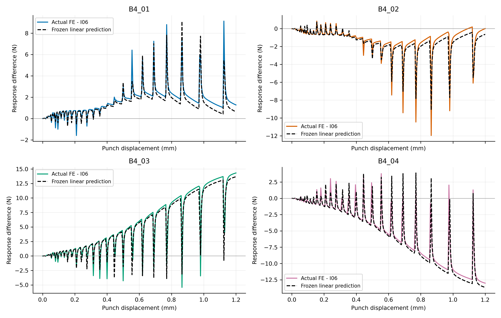
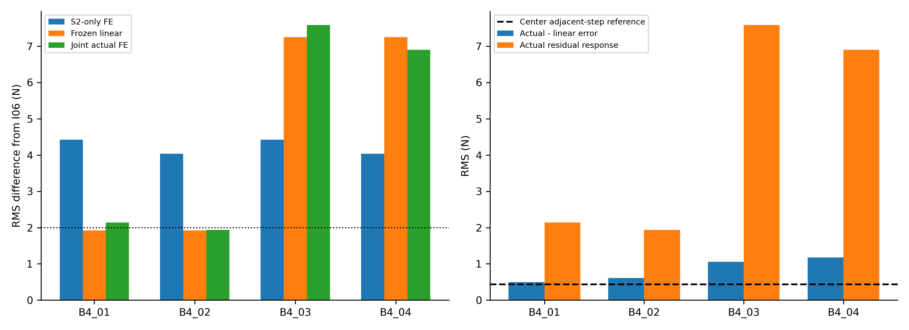
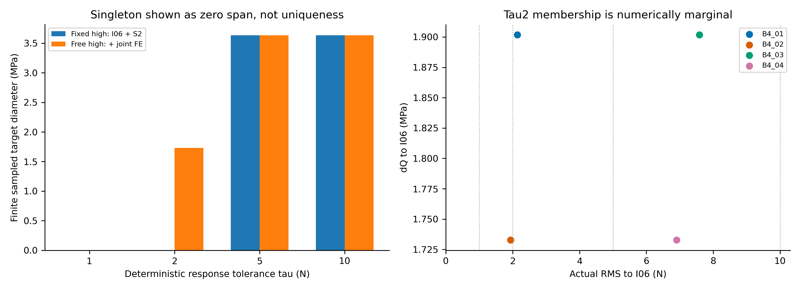
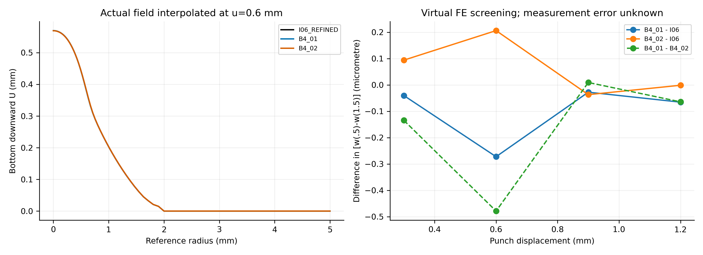

# run_077 — B4真实补偿机制前瞻检验

**四项真实FE确认反向补偿、同向增强；目标本构稳健歧义扩大仍未解决。** 4/4完成带警告，各DC+Full一次、零重试、808原生点、3cutbacks、无列示严重接受态异常。实际Project b9c0d50f-2655-4091-ae49-1bf08940acf8；身份、c2/c3、完整INP/ODBhash及数值质量见jobs.csv。MAIN与真实ODB/CAE Agent独立复核完成。没有新Solver、Datacheck、入队或优化。

| 候选 | 零对照RMS N | 主预测RMS N | 实测RMS N | RMS降低 N | 主预测误差RMS N | 最大差N@mm |
| --- | --- | --- | --- | --- | --- | --- |
| B4_01 | 4.423235340 | 1.918040294 | 2.142391666 | +2.280843674 | 0.497538222 | 9.131763@1.125 |
| B4_02 | 4.035453627 | 1.918040294 | 1.934924147 | +2.100529480 | 0.612400652 | 11.962782@0.865 |
| B4_03 | 4.423235340 | 7.247578642 | 7.588013694 | -3.164778354 | 1.055002741 | 14.315002@1.200 |
| B4_04 | 4.035453627 | 7.247578642 | 6.904887351 | -2.869433724 | 1.176547979 | 13.017517@1.200 |

反向完整RMS降低约52%，改善主要在中后段；不是每个位移误差都降低。主预测误差分别.498/.612/1.055/1.177N，原预测及阈值未改。所有contact尖峰保留；RMS相容不表示每点都在tau以内。

| tau N | 固定高段成员 | 自由高段成员 | 固定/自由D_Q MPa | 解释 |
| --- | --- | --- | --- | --- |
| 1 | I06_REFINED | I06_REFINED | 单点，非唯一性证明 / 单点 | 包络未扩大 |
| 2 | I06_REFINED | I06_REFINED,B4_02 | 单点，非唯一性证明 / 1.7328055888309266 | 单侧名义扩大、数值临界 |
| 5 | I06_REFINED,B2_S2_P,B2_S2_M | I06_REFINED,B2_S2_P,B2_S2_M,B4_01,B4_02 | 3.63458668595878 / 3.63458668595878 | 包络未扩大 |
| 10 | I06_REFINED,B2_S2_P,B2_S2_M | I06_REFINED,B2_S2_P,B2_S2_M,B4_01,B4_02,B4_03,B4_04 | 3.63458668595878 / 3.63458668595878 | 包络未扩大 |

两个补偿目标dQ=3.634586685959MPa，高段改变不影响各自epsilon<=.1目标，独立完整折点差0Pa。tau2仅B4_02名义通过、边距.0651N；B4_01在外、边距.1424N。均处数值敏感量级，不能报告两点均相容或稳健实现3.635MPa范围扩大。tau5/10目标包络不变。tau是确定性假设，不是仪器误差/置信界。单点集合不是唯一性证明，有限FE池不是全域界限。

H1已有局部支持保持；H2实际响应补偿SUPPORTED，目标相容范围稳健扩大UNRESOLVED；H3和H4 UNRESOLVED，正式外部材料验证NOT_EVALUABLE。保留历史信息暴露记录，本轮无真实拉伸读取/校准。

数值质量WARNING、分辨LIMITED：中心相邻增量RMS .432677914N不是端点误差界。PEEQ范围.698866–.707061<.9；ALLPD仅能量诊断，不能等同RF贡献。四阶段塑性场/接触图是真实输出。底面w(.5mm)-w(1.5mm)配对最大差约.4785μm，虚拟观测且未确认测量误差/数值精度，不是DIC独立判别。

建议先申请B3两个补偿端点数值核查，必要时第三项同层级中心，均需另行冻结/授权。暂停扩幅与新增观测FE，不为用满预算新增计算。实际Stage3用户FE20/40、剩余规划20，本轮Agent新FE/DC/Queue均0。

文件：fd_and_predictions_241.csv含I06、S2零对照、四实测及事前主预测（m/N方向转换后u_mm/N）；target_Q_981.csv为实际部署表转换的真总应变.002–.1/981点MPa；shape_features.csv记录夹持插值的实际U场；metrics.json完整冻结比较与限制；figures/01–08。无实验SPT/拉伸曲线、原始INP/ODB/CAE或private报告。用户明确授权发布的纯FE派生研究数据经过逐文件审查。

运行`python reproduce.py`从已发布CSV和未改变数学规则的frozen_comparator.py重算关键指标及相容集合。预测误差、odd/even、目标dQ及tau成员应与metrics.json一致；这只验证算术复现，不是独立材料验证。完整代码/来源和SHA见snapshot_manifest.json。

## Figures

Additional actual-data figures: [F-D and controls](figures/01_actual_fd_and_controls.png), [target constitutive curves](figures/04_actual_target_curves.png), [PEEQ/contact/energy](figures/06_actual_mechanism_diagnostics.png), [plastic zones](figures/08_actual_plastic_zones.png).
