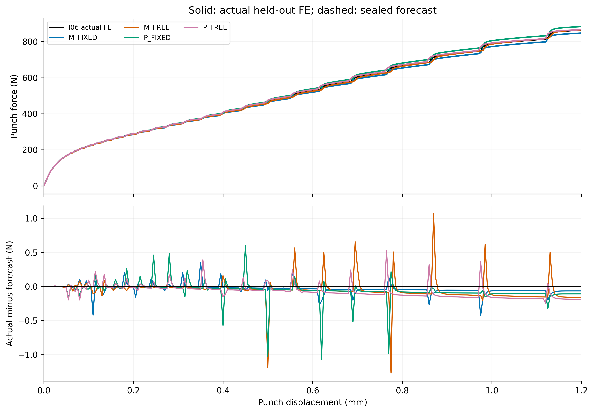
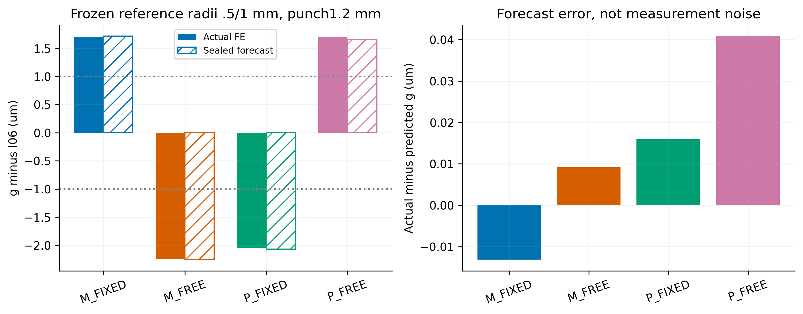
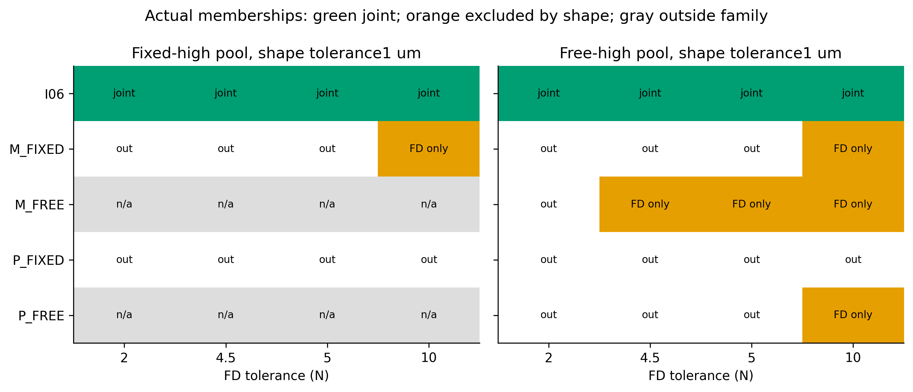
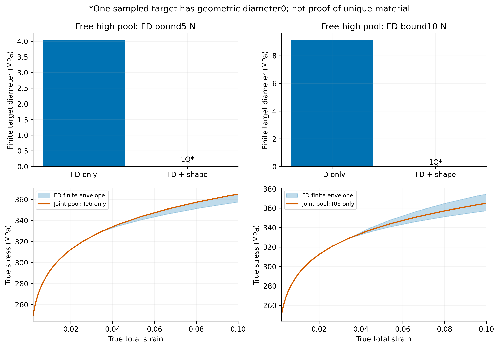
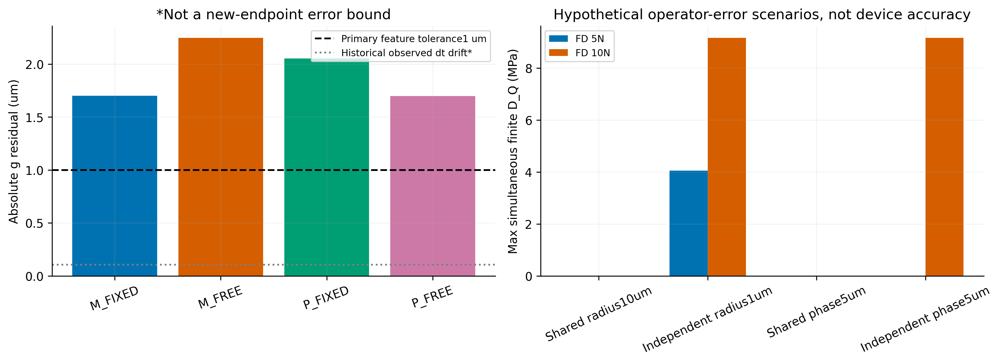
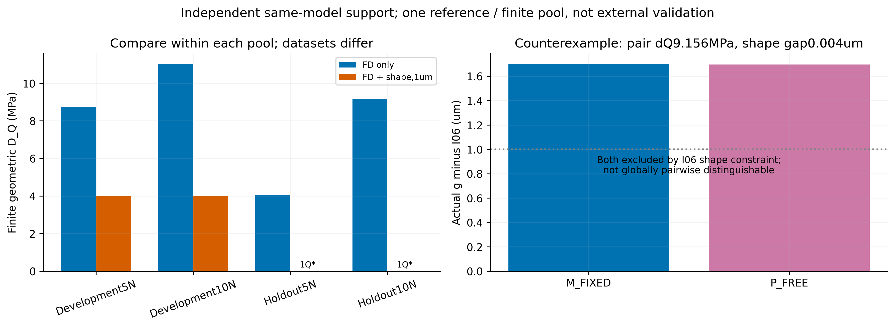

# run_088：H4 四项独立参数留出验证

冻结的底面形状观测在四项新参数案例上获得**同模型 FE 支持**。它能排除当前 I06 参考下的载荷相容、目标本构不同的候选；现实测量可行性仍未解决，不能据此宣布真实材料唯一可恢复。

本轮没有重新选择测点、参数、阈值或参考模型，没有训练或修改预测器。全部结果来自用户手动完成的四项 FE。分析启动的 Solver、Datacheck、Queue 和重试次数全部为 0。

## 执行身份与核验

真实 Project 为 `SP-InvOpt-40Job`，ID `b9c0d50f-2655-4091-ae49-1bf08940acf8`。四项均为 `COMPLETED_WITH_WARNINGS / SCOREABLE`，各执行一次 Datacheck、一次 Full，无重试，cutback=0。每项有 1601 个接受增量、1602 个原始历史点，完整覆盖 1.2 mm。完整 Job/Queue/运行 ID、INP/ODB SHA-256、时间和警告见 [jobs.csv](data/jobs.csv)。

数值契约：初始增量 0.0005、最大增量 0.000625、最小增量 1e-12、步时间 1、最大增量次数 999999，14 CPU / 0 GPU。参考为既有同层级 I06，未重算中心。最大 PEEQ 为 0.699149–0.706695，材料表上限 0.9。保留 ZERO_MOMENT 接受态警告和解析刚体接触跟踪方式转换提示；ALLSD=0，不意味着接触或时间离散误差为零。

真实 ODB 专业提取、CAE 实际部署材料检查与 MAIN 原生历史/形状独立复核均已完成。所有保存帧的 Punch RP Field/History U2、RF2 一致。原始文件只读前后哈希一致。与既有细化中心的物理模型、材料族和数值契约一致。

## 事前封存与真实预测误差

run_085 的 manifest、六项预测封存文件及 run_084 冻结协议在新科学响应读取前校验；预测封存亦早于实际 Datacheck 日志。完整来源哈希与契约见 [provenance.json](provenance.json)、[evaluation_contract.json](evaluation_contract.json)。

`a=ln(1.1)`。M 固定/自由分别为 `(c2,c3)=(-2.5a,0),(-2.5a,+2.5a)`；P 固定/自由为 `(+2.5a,0),(+2.5a,-3a)`。锚点保持 I06 的 sigma_y=236.49902622197678 MPa、n=0.0968。c2/c3 是硬化率对数扰动，不能当作新的 Hollomon sigma_y/n 样本。

| 候选 | 实际 F–D RMS 对 I06 / N | 封存预测 RMS / N | 整条预测曲线误差 RMSE / N | 实际 g−gI06 / μm | g 预测误差 / μm |
|---|---:|---:|---:|---:|---:|
| M_FIXED | 9.422039 | 9.375368 | 0.079324 | +1.700963 | −0.013151 |
| M_FREE | 3.945991 | 3.954552 | 0.180361 | −2.247175 | +0.009187 |
| P_FIXED | 11.880014 | 11.944499 | 0.159033 | −2.051641 | +0.015911 |
| P_FREE | 5.768508 | 5.808522 | 0.123445 | +1.696902 | +0.040815 |

四个候选在预注册阈值、候选族和观测模式下的 64 项**规则检查**均与封存预测一致。这不是 64 个独立 FE 测试。事前没有冻结预测误差的统一 PASS 阈值，因此仅报告误差与规则一致性，不事后创造合格线。

最大局部曲线预测误差约 0.430–1.272 N，所有尖峰和全部 241 点均保留。四阶段误差及最近接触事件另列于 [analysis](analysis/)；时间接近只能用于诊断，不能证明接触是唯一误差成因。

## 冻结观测与目标本构

主观测始终为压头位移 1.2 mm 时 `g=w(r_ref=0.5 mm)−w(r_ref=1.0 mm)`，`w=−U2`。半径是初始底面材料坐标，不是变形后相机位置。按真实压头位移和参考半径进行有界线性插值，不外推。

F–D 使用 `u=−U2, F=−RF2`，0–1.2 mm、241 点；无平移、平滑或删点。目标 Q 为实际部署材料表重建的真应力–真总应变，在 0.002–0.10 的 981 点计算 d_Q。相同 c2 的固定/自由候选 Q 完全一致，高段未污染目标窗口。PEEQ 不等同于单轴真总应变。

固定池为 `{I06,M_FIXED,P_FIXED}`；自由池包含固定池并增加两个 FREE。以下候选数均含中心，形状阈值均为冻结的 **1 μm 差分特征容差**。

| τF / N | 固定池 F–D 候选数 / D_Q MPa | 自由池 F–D 候选数 / D_Q MPa | 加形状后 | 收益判定 |
|---|---|---|---|---|
| 2 | 1 / 单一目标 | 1 / 单一目标 | 中心 | NOT_EVALUABLE：原池无不同目标 |
| 4.5 | 1 / 单一目标 | 2 / 4.047861 | 中心 | 自由池有限歧义被排除 |
| 5（主） | 1 / 单一目标 | 2 / 4.047861 | 中心 | 自由池有限歧义被排除 |
| 10（辅） | 2 / 4.047861 | 4 / 9.155854 | 中心 | 两族有限歧义被排除 |

主情景的自由池为 I06 与 M_FREE；辅助情景增加 M_FIXED 和 P_FREE。联合约束后只有中心，有限集合的**几何直径为 0**，但正式多目标 D_Q 记 NULL / SINGLE_TARGET_NOT_UNIQUENESS，绝不解释为材料唯一。τg=0.1、0.25、0.5 μm 的全部冻结情景也按相同规则给出，而非重新选阈值。见 [compatibility_scenarios.csv](analysis/compatibility_scenarios.csv) 和 [981 点包络](analysis/target_envelopes_981.csv)。

M_FREE 在主情景的 F–D 内边距为 1.054009 N，形状排除外边距为 1.247175 μm。辅助情景最小形状排除边距为 0.696902 μm。τ 均为确定性研究情景，不是实测噪声或统计置信界。

## 必须保留的反例与测量风险

**单个形状特征不能普遍区分全部本构。** M_FIXED 与 P_FREE 的目标距离为 9.155854 MPa，而形状差仅 0.004061 μm。二者分别相对 I06 形状偏移约 +1.7 μm，均会被本次参考约束排除，所以不否定预注册的 I06 中心检验。但二者之间仍存在形状退化。其直接 F–D 距离为 14.338910 N，不能混同各自相对中心的距离。所有直接配对见 [pairwise_distances.csv](analysis/pairwise_distances.csv)。

既有三组同材料粗细层观察到的最大 g 变化约 0.104986 μm。主/辅最小排除边距大于该观察尺度，但它**不是四个新端点或网格误差的上界**，不能证明严格数值收敛。

沿用 run_085 的共享/独立定位和时间同步情景，共计算 448 项场景；没有重新挑选误差模型或测点。实际 U 场支持的结果如下：

- 共享同一标定算子时，半径共同偏差 ±10 μm、共同后向压入同步偏差至 5 μm，主/辅场景仍只保留中心。
- 各试样、各测点独立半径偏差 **±1 μm** 的假设情景，已允许目标几何直径恢复到 F–D-only 的 4.047861 / 9.155854 MPa；收益不保证保持。
- 独立后向同步误差至 1 μm 时仍只保留中心；至 5 μm 时主情景保持，辅助情景可能恢复 9.155854 MPa。

所有最大同时相容池使用同一个 I06 参考误差实现，不把分别可能的候选简单拼成不可同时实现的集合。共同偏差抵消只适用于候选和参考经历同一观测算子的比较；不能将真实错位观测对理想无偏 FE 参考的比较也假设为抵消。没有 1.2 mm 之后的输出就只分析后向时间情景，不外推前向。

这些是确定性误差情景，不是设备精度测量。1 μm 为差分特征容差，不是每个点允许 1 μm。若它已代表总误差预算，不能再与额外定位误差双重计入。绝对 g 误差与 g−gI06 残差误差在 [位置](analysis/position_absolute_vs_residual.csv)、[时间](analysis/phase_absolute_vs_residual.csv) 表中分开。

## 科学状态与下一步

| 维度 | 判定 | 范围 |
|---|---|---|
| EXECUTION | PASS | 四项真实用户计算、身份完整 |
| NUMERICAL_QUALITY | WARNING | 警告保留，具评分资格 |
| NUMERICAL_RESOLUTION | LIMITED | 同层级对照成立，无新端点收敛证明 |
| H2-B | SUPPORTED | 当前同模型有限候选池 |
| H4-A | SUPPORTED | 既有开发集筛查结论不改 |
| H4-B | SUPPORTED（有数值限制） | 冻结形状方案在四个新参数留出上复现 |
| H4-C | UNRESOLVED | 真实设备、材料点定位、同步相关误差未知 |
| TARGET_RECOVERABILITY | LIMITED | 有限集合歧义排除，非全域唯一 |
| EXTERNAL_VALIDATION | NOT_EVALUABLE | 无新的独立材料实验真值 |

本轮支持论文中的同模型前瞻数值观测命题，不支持真实 SA508 已准确恢复、全局唯一性或仪器精度声明。历史信息暴露声明及正式真实材料验证 NOT_EVALUABLE 保持，不使用已解盲拉伸曲线调参。

建议立即新增 FE 预算 **0**：先核查现有装置是否可观察底面、能否追踪初始材料点，以及定位、同步误差的相关性和重复性；不自动联系合作方或要求采购。底面形状仍为主方案，第二厚度为设备不可测或稳健性不足时的后备，现有 ODB 不能验证第二厚度。

如论文需进一步量化主情景的端点时间稳定性，可单独申请 **2 项**更细层级的 M_FREE 与 I06；这只覆盖主情景关键端点，不能代替另外三项或整个固定/自由池的同层级审查。辅助 10 N 全池结论需要另行覆盖其相关端点。当前不准备或执行这些 Job。真实材料层面的外部验证仍需新、可溯源的配对试验；重复数应根据先导测得变异制定，不能凭本 FE 数据承诺。

Stage 3 实际新增 FE 为 **45/100**，剩余规划 **55**。科研审查、公开性审查与 GitHub 同步独立验收。

## 数据与复现

本快照只含获准公开的虚拟 FE 派生曲线、形状剖面、目标曲线和算法。没有合作方实验、原始模型、完整网格/节点拓扑、私有报告、ODB、CAE、INP 或数据库。

已有 Python（本轮使用 3.11.13）及 NumPy 2.1.2、Matplotlib 3.10.5 即可执行 `python reproduce.py`，输出写到 `reproduced/`，不调用 Abaqus、网络或任何拟合。四个区间采用闭区间诊断，共享边界点只在分段统计中重复，不改变完整 241 点 RMS。脚本及输入文件完整 SHA-256 见 [snapshot_manifest.json](snapshot_manifest.json)。只读原生提取和私有来源审计在本地保存，公开结果可从标准化 CSV 重新计算。
