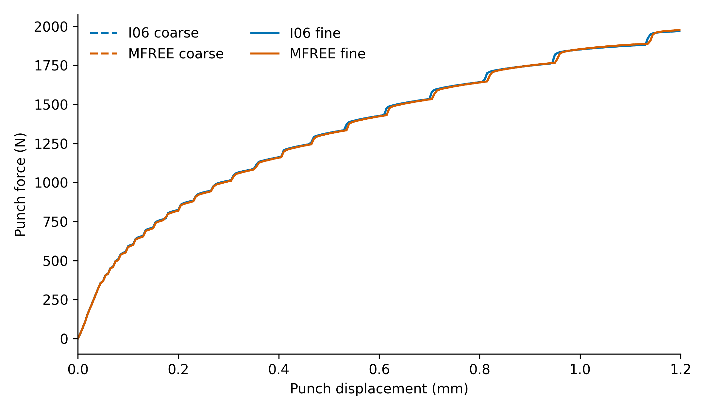
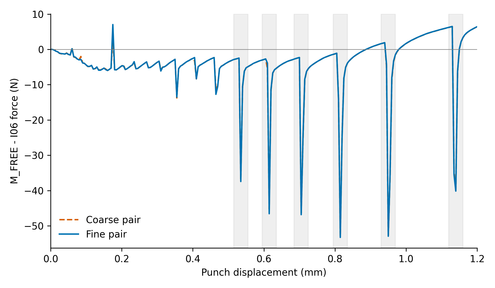
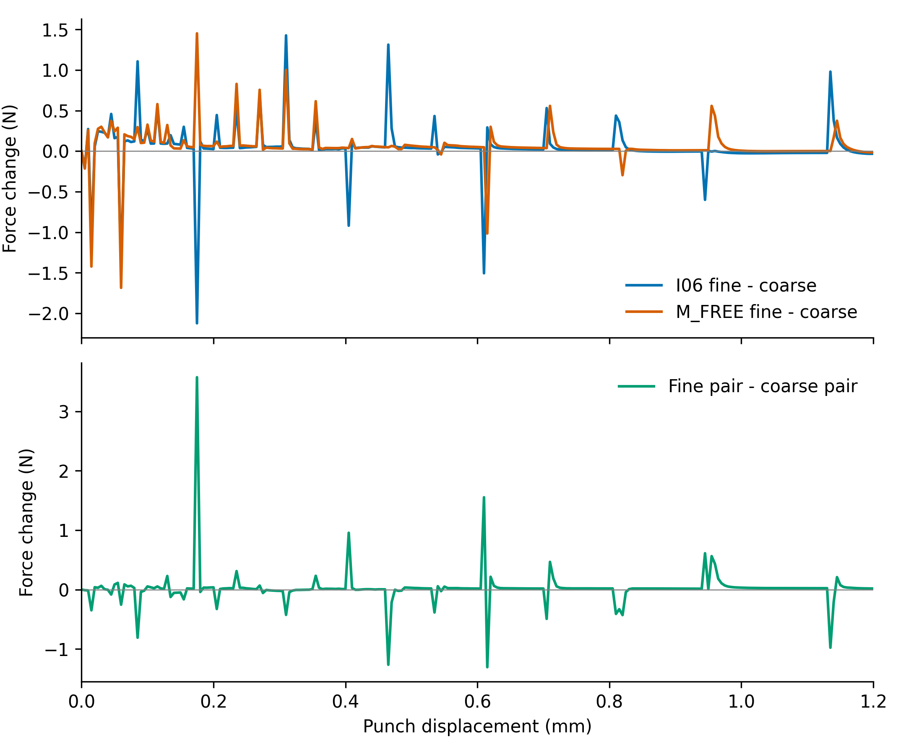
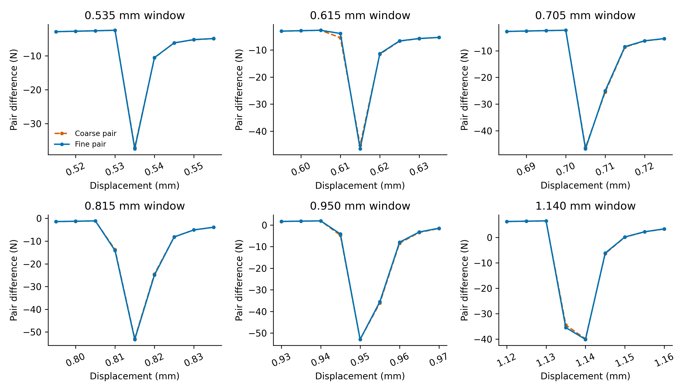

# run_097：1.0 mm I06/M_FREE 成对时间增量稳健性审查

生成日期：2026-11-23T14:33:11.300641+08:00。真实 FE，合成 I06 参考；不是实测实验噪声或外部材料验证。

## 科学结论

**本次时间增量减半没有消除原有材料配对差异，也没有改变九组冻结相容性分类。** 配对 RMS 增加0.068227480 N（约0.729%），差向量方向余弦0.999458893。因而，原9.359705 N差异不能主要归因于本次所检验的时间步粗细变化。该结论限于这对材料、同一网格与接触算法、两个相邻时间层级。

Main选择 **C：总体稳定、局部与机制仍有限定**。时间增量维度已支持进入机制问题的设计；尚不能宣布双厚度提供的独立本构信息已通过空间离散验证。优先一个两材料共同的空间离散对照，有明确决策用途；不继续无目的减半时间步，也不先扩大材料矩阵。

## 真实执行与评分资格

本批两个 Job 由用户分别手动启动。正式执行 Project 为 `b9c0d50f-2655-4091-ae49-1bf08940acf8`。I06 Queue 为 `q_5b5aa6827ddc4f62a1f69cc323a5daee`，M_FREE Queue 为 `q_7562428c86ac463dbc81e7d74755fde4`。均为 `COMPLETED_WITH_WARNINGS`、软件 verdict SUCCESS、阶段 exit=0；每项一次 Datacheck、一次 Full、0重试、0 cutback、3201接受增量、3202原生历史点，完整达到1.2 mm。14 CPU/0 GPU。

两项细层初始增量0.00025、最大0.0003125；原层分别0.0005和0.000625。CAE核验冻结输入、运输副本、材料及非材料模型身份，唯一授权数值改变为这两个时间增量。M_FREE与I06的预设材料不同，其余物理/数值合同一致。

M_FREE queue耗时1001 s（DC 41 s、Full 960 s）；I06 queue2251 s（DC 50 s、Full 2198 s）。耗时差不是力学证据。M_FREE最终载荷1975.947388 N。M_FREE/I06最大PEEQ分别0.757289708/0.765455365，小于各表0.9；PEEQ不等于真总应变。M_FREE末态ALLPD=1.576047778 J、ALLWK=1.611318588 J，最大|ETOTAL|/末态ALLWK=2.17e-6；ALLAE/ALLSD为零。能量账可读且一致，不证明本构真实性或网格收敛。

保留路径式接触跟踪退回状态式跟踪警告、零力矩判据警告和接受增量内严重不连续迭代。M_FREE/I06分别205/220个接受增量包含这种迭代，累计263/278次；这不等于接受了未收敛增量。M_FREE的120条迭代穿透过大消息分布于79个增量，不能当作120次最终失效。四保存阶段Field/History U2/RF2一致、抽查detJ正；不把四帧检查升级为所有网格所有时刻认证。两项均 **SCOREABLE_WITH_LIMITATIONS，NUMERICAL_QUALITY=WARNING**。

## 完整曲线与数值差异

观测继续使用原生m单位的 `u_mm=-1000 U2`、`F_N=-RF2`，0–1.2 mm共241点，线性插值，无零点移动、平滑、删点或外推。Main从四条原生历史独立重建，原冻结评估器和原IV的241点结果相同。四段各61点，共用端点；全曲线241点各计一次，分段平方和不可直接相加。

| 指标 | N |
|---|---:|
| I06 自身粗细 RMS | 0.293871858 |
| M_FREE 自身粗细 RMS | 0.239258181 |
| 粗层材料配对 RMS | 9.359704502 |
| 细层材料配对 RMS | 9.427931982 |
| 两层配对差向量变化 RMS | 0.316468586 |

粗细配对差变化最大 **3.574475735 N @0.175 mm**；I06自身最大2.123027851 N@0.175 mm，M_FREE自身最大1.685634616 N@0.060 mm。粗层最大材料差52.931861969 N@0.950 mm，细层53.257192952 N@0.815 mm。最大值位置改变是必须保留的反例。

| 位移段 / mm | 粗层配对 RMS / N | 细层配对 RMS / N | 配对差向量变化 RMS / N |
|---|---:|---:|---:|
| 0.0–0.3 | 4.252873 | 4.327212 | 0.479183 |
| 0.3–0.6 | 6.813052 | 6.876220 | 0.220635 |
| 0.6–0.9 | 12.350812 | 12.470619 | 0.290616 |
| 0.9–1.2 | 11.376250 | 11.402116 | 0.181510 |

## 接触阶梯：关联持续，因果仍未隔离

六个冻结窗口是0.535、0.615、0.705、0.815、0.950、1.140 mm各±0.020 mm，联合54点。配对差平方和贡献由 **84.312870%变为84.219058%**；窗口主导现象保持。另一方面，两层配对差向量变化的平方和只有30.142660%在这些窗口，约69.86%在窗外。两种分母代表不同问题，不能混用。

| 冻结中心 / mm | I06 峰位细−粗 / μm | M_FREE 峰位细−粗 / μm | 材料峰滞后粗层 / μm | 材料峰滞后细层 / μm |
|---:|---:|---:|---:|---:|
| 0.535 | -0.224973 | -0.225031 | 3.750029 | 3.749970 |
| 0.615 | -0.600005 | -0.600005 | 5.249982 | 5.249982 |
| 0.705 | -0.600005 | -0.600005 | 6.749993 | 6.749993 |
| 0.815 | -0.600005 | -0.224973 | 7.499999 | 7.875031 |
| 0.950 | -0.224973 | -0.600005 | 9.000010 | 8.624978 |
| 1.140 | -0.600005 | -0.224914 | 6.749993 | 7.125083 |

细层材料峰滞后3.750–8.625 μm，而同材料粗细峰漂移0.225–0.600 μm。在该时间层级变化下，材料间事件时序差持续。原生峰按冻结窗口内ΔF/Δu识别，未以241网格位置冒充原生事件时间。细层12个峰均在最近的CPRESS>0节点集合变化后一增量；24个粗细峰中2个同帧、22个晚一帧。0.615 mm附近有多次接触集合改变，部分末段峰有相近候选峰，因此不声称唯一清晰转变点。

每增量ΔF在细层约减半，主要伴随采样增量减半，不能解释为阶梯消失。峰斜率细/粗约0.972–1.112。CPRESS正值节点集合可以检验压力激活关联；ODB没有CSTATUS和完整主面片匹配，**严格接触状态/主面转换归因为NOT_EVALUABLE**。这些关联不构成反力因果分解，更不涉及模型未包含的微观机制。

## 九组冻结相容情景与尺度

0.5 mm块继续使用原冻结配对RMS=3.945991204 N及5 N情景。1.0 mm块独立采用2/5/10 N与0.5/1/2%两个条件的AND；各层用自己的I06 RMS归一化。细层I06尺度1428.952765743 N，材料相对差0.659779120%；不是把0.5 mm的5 N当作1 mm噪声。

| 1 mm 绝对上限 / N | 相对上限 / % | 粗层 | 细层 | 细层绝对边距 / N |
|---:|---:|---|---|---:|
| 2 | 0.5 | 排除 | 排除 | -7.427932 |
| 2 | 1 | 排除 | 排除 | -7.427932 |
| 2 | 2 | 排除 | 排除 | -7.427932 |
| 5 | 0.5 | 排除 | 排除 | -4.427932 |
| 5 | 1 | 排除 | 排除 | -4.427932 |
| 5 | 2 | 排除 | 排除 | -4.427932 |
| 10 | 0.5 | 排除 | 排除 | 0.572068 |
| 10 | 1 | 相容 | 相容 | 0.572068 |
| 10 | 2 | 相容 | 相容 | 0.572068 |

九格均不变：7格排除、2格保留。10 N绝对边距由0.640295498降至0.572068018 N。配对差向量变化0.316468586 N相对原配对RMS为3.381%，相对这个0.572 N边距已不是任意小的量；它不是严格误差界，不能据此保证空间细化后仍分类不变。所有容差均为冻结的确定性情景，严格误差上界及实验噪声协方差仍为空。

额外描述性尺度检查：0.5 mm相对差约0.694051%，1.0 mm细层约0.659779%，故较大的N差不能单独证明增加独立信息。归一化配对曲线方向余弦约0.292346，提示形状并非纯等比例放大，但仍混合了不同厚度的接触/空间离散影响；0.5 mm仍用最大增量0.000625，因此这不是同层级双厚度Jacobian或全域可识别性证明。本诊断不改变九格主评价。

## 专业协作与独立复核

原CAE对输入、原生日志及ODB场/能量证据完成独立资格检查；原ODB只读提取新结果并执行封存评估器；Main独立重建四条原生曲线、六窗口与接触CSV；原Independent Validation再次独立计算并回读角色制品。Hub的任务完成仅表示登记，不代替科学判断；IV使用原专门对话与文件回执，不伪造Hub IV角色。

IV审查文件SHA-256：`51583293198f9dd50839ade1a3a9033778d5bd221b0d9020f78a815a1168208a`。完整独立意见保留本地；核心限制包括缺少空间离散对照、CPRESS代理的因果解释限制、确定性容差而非噪声、两材料不能证明全域本构唯一。

## 下一步：一次能改变科学决策的最小对照

**建议申请两项共同径向接触面网格细化（I06、M_FREE），本轮不生成或执行。** 在当前细时间层保持材料、几何、摩擦、算法、加载、输出及厚度分层，目标接触面径向间距减半；CAE需先验证网格过渡与全部实际差异。这隔离空间离散族，仍包含径向结构刚度变化，不能称为仅改变接触算法。

用完整241点配对向量、原九格/边距、六窗口及窗外全部数据、按物理半径匹配的压力推进与事件滞后判别两个竞争解释：

- 若配对形状、分类和材料接触推进滞后在更密空间离散下保留，支持进入低/高段有限幅机制对照；无需先追求无限次时间减半。
- 若差异明显随节点间距衰减、旋转或分类变化，则当前所谓附加信息部分依赖离散，优先解释这种依赖，暂不扩大反演材料矩阵。

具体定量预期和接受规则需在后续输入冻结前预注册，本报告不为新结果事后制定阈值。后续机制方案优先缺失的两个因子角S2-only与S3-only，和同网格I06/M_FREE形成四角，检验有限幅相互作用F23−F2−F3+F0；各低段自身连接点变化必须计入，不称为严格局部导数。若换网格，四角必须一致，不能用旧网格对照充数。该机制方案是条件性建议，不是本轮授权。

## 状态、预算及复现

EXECUTION=PASS；NUMERICAL_QUALITY=WARNING；NUMERICAL_RESOLUTION=LIMITED；相邻时间增量配对稳定性=SUPPORTED_WITH_LIMITATIONS；接触因果与稳健新增独立本构信息=UNRESOLVED；TARGET_RECOVERABILITY仅限两材料九情景；EXTERNAL_VALIDATION=NOT_EVALUABLE。

Stage 3已完成49项，规划参考约200，规划余151；不是必须用满，也不是统一求解授权。本次批后分析新增Solver/Datacheck/Queue/retry全部0；run_097此前授权的两次queue-only登记与用户手动完成两项计算单独留档。

发布仅限经审查的项目自有FE派生曲线、数值、图与复现程序，无合作方实验数据、私有报告复制、原始INP/ODB/CAE或Hub凭据。`jobs.csv`列完整INP/ODB身份，`metrics.json`记录源数据/协议/代码哈希，`snapshot_manifest.json`登记发布文件。`reproduce.py`从公开241点数据复算主要数值和四图；接触原生峰摘要保留在CSV，重新ODB提取仍需本地原始文件。单纯Git成功不提升科研等级。
